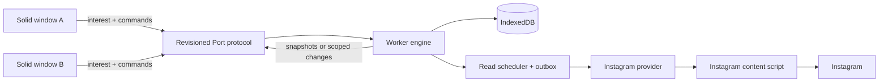
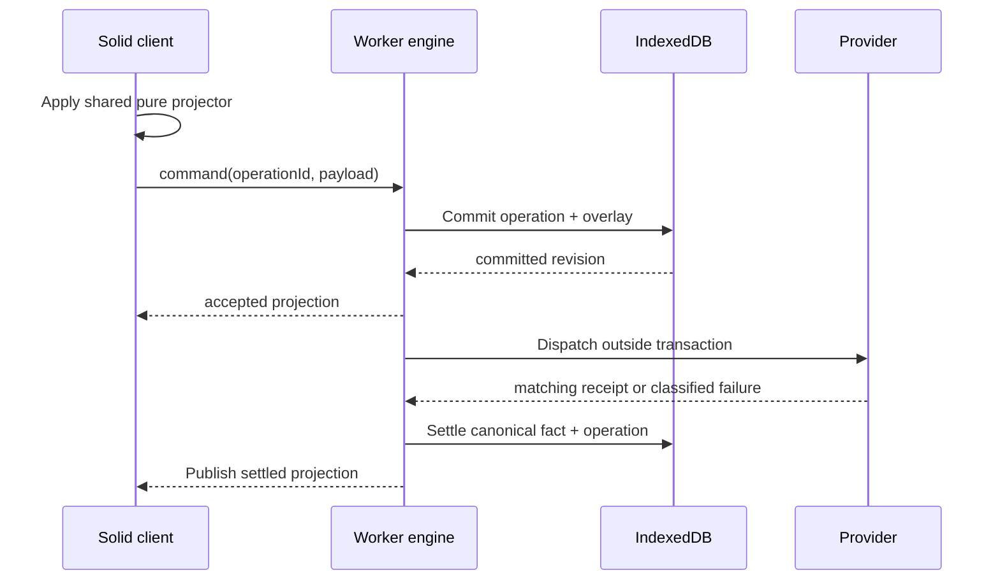

# Application architecture contract

**Status:** intended architecture for the restored product. This document fixes
ownership and correctness boundaries; the
[restoration checklist](solid-restoration-checklist.md) controls delivery order.
Features not yet restored must still enter through these boundaries.

## Non-negotiable shape

The extension is a local client/server system. The MV3 worker is the local
server; every Solid window is a disposable client. Instagram is an external
provider, not an application state store.



There is exactly one production UI runtime (`/ui.html`, Solid 2), one canonical
worker engine, one account-partitioned database, and one closed provider
capability surface. Do not add a UI-owned canonical store, direct component RPC,
a second cache, or parallel sync/mutation authority.

The MV3 worker uses one `ManagedRuntime` from the exactly pinned Effect 4 beta
(`effect@4.0.0-beta.107`). This prerelease API is unstable and must be migrated
deliberately when the pin changes. Provider, repository, and
engine are switchable services/layers; production assembles one shared provider
instance and one engine layer. Engine workflows and concurrency are Effects,
and subscription/bootstrap/shared producer fibers belong to the engine layer
scope. Host Promise commands and callback roots enter through that same
`ManagedRuntime`; disposal interrupts roots and scoped producers. Provider scope
cleanup closes Ports and pending local requests, including startup readiness.
Pure normalization/domain code and the Solid UI remain plain TypeScript. Promise
and callback adapters exist only at browser-host and compatibility-test
boundaries. IndexedDB transactions, commit revisions, and account epochs—not a
runtime fiber—are the durability boundary across worker suspension.

## Ownership boundaries

| Layer                   | Owns                                                                                                                            | Must not own                                                           |
| ----------------------- | ------------------------------------------------------------------------------------------------------------------------------- | ---------------------------------------------------------------------- |
| Instagram boundary      | Authentication extraction, captured request descriptors, network calls, external JSON validation, protocol error classification | Cache policy, optimistic state, routes, DOM state                      |
| Repositories            | IndexedDB schema/migrations, account partitions, transactions, normalized facts, resource indexes, durable operations           | Request priority, DOM state, presentation                              |
| Worker engine           | Cache-first reads, resource state, canonical merges, command acceptance, overlays, account epochs, subscriptions                | Instagram payload aliases, DOM geometry, drafts                        |
| Scheduler/outbox        | Shared flights, interest priority, retry timing, cancellation, durable operation dispatch and settlement                        | Entity interpretation, presentation                                    |
| Solid projection client | Port lifecycle, sequence/epoch recovery, bounded replica, same-frame speculative command projection                             | Canonical merges, persistence, cursor selection, provider calls        |
| Solid features          | Routes, drafts, focus, scroll anchors, dialogs, native media-element state, rendering                                           | Canonical entities, freshness, mutation settlement, Instagram protocol |

Top-level entrypoints only compose owners and register listeners. Protocol
details belong at the provider boundary; transaction details belong in
repositories; state surgery belongs in the engine or pure reducers.

## Identity and privacy

All Instagram-derived records, resources, operations, and activity events are
partitioned by authenticated `accountId` (`ds_user_id`). Message `viewerId` and
thread `key`, `threadFbid`, and `threadIgId` are distinct identifiers and are
never substituted for one another.

Before publishing persisted account data, the worker obtains current identity
evidence from the provider. A detected identity change:

1. advances the account epoch;
2. rejects obsolete completions and scheduling intent;
3. clears every connected client projection;
4. switches database partitions without merging records.

Without trustworthy current identity, the app does not automatically reopen a
cached account. Any future offline account chooser must be explicit, labeled
read-only, and unable to dispatch commands before provider identity is verified.
Cookie evidence reduces exposure risk but cannot prove that every external
account switch is observable.

## Canonical data model

Facts are normalized by stable domain identity. Ordered resources contain IDs,
never embedded entity copies.

Parser-synthesized message IDs are conversation-scoped at normalization; their
sender/timestamp fallback is not globally unique. Keep `isSyntheticId` and never
treat such cache keys as provider message IDs or mutation receipt evidence.

```ts
type Resource = {
    key: string;
    orderedIds: string[];
    cursor?: string;
    hasNextPage: boolean; // Provider continuation, not local retention capacity.
    /** Local resource capacity, distinct from provider exhaustion. */
    retentionLimited?: boolean;
    fetchedAt: number;
    availability: 'absent' | 'present';
    freshness: 'fresh' | 'stale';
    synchronization: 'idle' | 'queued' | 'refreshing' | 'error';
    error?: EngineError;
    failedOperation?: 'refresh' | 'continuation';
};
```

Representative keys are `inbox:primary`, `history:<threadId>`,
`comments:<mediaId>`, and `commentReplies:<commentId>`. Cursors are opaque and
selected by the worker. Components never inspect or construct them.

The durable model grows by migration from these owners:

- account metadata and schema version;
- users, threads, messages, media, and comments by `[accountId, id]`;
- resources by `[accountId, key]`;
- operations by `[accountId, operationId]`;
- local activity events by `[accountId, eventId]` when that product scope ships.

Global presentation preferences are the exception: small intentional globals
live only in `storage.local`. Media bytes, auth secrets, and proxied data URLs
are never persisted.

Resource writes update their own references. Refreshing inbox page one must not
delete facts retained by another inbox page, history, media, or pending
operation. Retention is bounded and reference-aware; unsettled operations are
never evicted. Runtime bounds and durable retention are separate policies: small
client/worker projections do not justify deleting successfully loaded history
from IndexedDB.

Reference-aware means transitive over current facts: retaining a thread also
retains its current participants and latest-message reference. A resource's old
reference list must not orphan dependencies after another resource updates that
shared thread. Projection selection follows the same dependency rule as pruning.

## Read contract

A query publishes authorized persisted data first and refreshes second. The
three resource dimensions are independent: cached content may be present,
stale, and in an error state simultaneously. Refresh never replaces usable
content with a loading takeover; loading UI is reserved for truly absent data.

There is one live read flight per `(accountId, resourceKey, cursor)`. Multiple
clients and prefetch intents join it. Explicit user work outranks visible
missing resources, which outrank bounded nearby speculation. Interest removal
invalidates and detaches eligible history flights on the last listener, then
interrupts their scoped producers without taking the commit lane. Other waiters
do not own shared producer cancellation. Cancellation remains best effort, so
account/epoch/generation checks still guard every completion. Lane acquisition
and network waits remain interruptible; once persistence starts, commit revision,
entity acceptance, installation, and publication reconcile together before lane
release or repository closure.

Pagination preserves exact cursors, deduplicates stable IDs, and failure-gates a
cursor until explicit retry. A successful response that repeats its cursor and
adds no IDs is a retryable no-progress failure, not a loop.

Retained facts are not proof of contiguous coverage. Refreshing an inbox or
history head establishes a new active page chain. A retained next page rejoins
that chain only when its request cursor matches the preceding page's returned
cursor exactly. Otherwise it remains detached retained data, subject to the same
retention budget, and is excluded from active ordering and exhaustion claims.
Do not concatenate cached ranges across an unproven gap.

The durable default is to retain every successfully loaded page for the active
conversation and a bounded recent-conversation set. Under account-level storage
pressure, evict whole least-recently-used inactive histories before considering
individual pages. Never evict active/subscribed or recent protected histories,
unsettled operations, or facts referenced by another resource. Reopening an
evicted history is an honest cache miss starting from newest history.

This policy does not require moving per-conversation ranges or bidirectional
pagination for ordinary scrolling. Exact cursor linkage is still required to
claim contiguous coverage, but retained active history grows through its proven
older chain. Provider exhaustion remains distinct from storage pressure.
Failures and explicit retries belong to the head refresh or exact continuation
cursor that failed. A head refresh cannot silently clear a still-active
continuation failure.

Shared normalized facts can occur in several resources. Serialized commit
acceptance must preserve a fact accepted after an overlapping request started,
even when that older request's resource generation is still current. History
viewer evidence is separate: an older-page fallback can fill a missing viewer,
but cannot replace the viewer established by initial detail.

Freshness values and concurrency budgets are centralized scheduler policy. They
may change after measurement without changing ownership or data contracts.

## Command and outbox contract

The UI may apply a deterministic speculative projection in the input frame, but
the worker accepts a command only after an IndexedDB transaction durably records
its immutable intent and affected overlay. No network request runs inside that
transaction.



Deduplication key is `(accountId, operationId)` plus immutable payload. Identical
redelivery returns the same acceptance; reuse with different payload is
rejected. Separate user commands remain separate even when their payloads look
the same.

Canonical server facts are not overwritten optimistically. Projected values are
derived by replaying ordered pending overlays over canonical facts. New reads
replace or merge canonical facts, then replay applicable overlays, so stale
responses cannot regress accepted intent.

Receipts must match target identity and requested final state. Commands
serialize per conflicting target, not through one global queue. Automatic replay
is allowed only for idempotent or independently reconcilable operations. An
unknown outcome for a non-idempotent command remains durable and is never
blindly retried.

## Client stream contract

Every worker lifetime has a worker epoch; every authenticated partition has an
account epoch; every durable commit has a monotonic `commitRevision`. Each
client subscription has its own generation and contiguous sequence.

The worker sends an authorized snapshot at a commit revision, followed by
coherent scoped updates. A client ignores duplicate sequences and requests a
fresh snapshot after a real gap, reconnect, worker-epoch change, account-epoch
change, or subscription-generation change. Commits outside a client's interests
do not create sequence gaps. A durable replay log is not part of the design.

Complete snapshots remain valid while small. Scoped change batches may replace
them when measured payload or update costs justify it; that transport choice
does not move canonical ownership into the UI.

Complete means complete for a client's bounded interests, not the whole retained
database. Include the inbox, subscribed detail, and a small declared warm-navigation
working set. Retained histories outside that set remain worker/database-owned;
loading one is a cache hydration, not permission for a second client cache.

Snapshot data and revision are read coherently. Before publication, acceptance
is serialized with commits and checks account epoch, subscription generation,
and revision. A stale hydration result is discarded and reread, not published
over a later accepted projection. This does not require a replay log.

## Solid application contract

The Solid projection uses `createStore` for normalized dictionaries and draft
setters/`reconcile` for updates. Components iterate stable ID arrays with
`<For>` and select entities by ID. Props remain intact. Primitive window state
uses signals; derived values use memos rather than mirrored effect state.

Effects separate tracked computation from imperative application. Port, DOM,
observer, and media resources are disposed with their Solid owner. Async memos
do not fetch Instagram data, and no query library owns a parallel cache.

Per-window state includes only routes, drafts, bounded viewport IDs, logical
scroll anchors, focus targets, dialogs, and native player state. Cursor,
freshness, retries, canonical entities, and operation settlement remain worker
state.

Rendering is always bounded:

- inbox rows are fixed at 72 px and at most 31 are mounted;
- message history mounts at most 80 rows and consumes cached IDs before network;
- every future list declares and tests its own mount bound before shipping.

History stores an ID-plus-offset anchor and corrects it after prepend or measured
size changes. Maintenance scrolling is immediate, not animated. Motion never
animates row placement or layout, and system reduced-motion is honored from the
first version of every restored surface.

Desktop may use a two-pane Messages layout; compact navigation is real route
state with Back restoration, not CSS-only hiding. A navigation rail appears only
after multiple destinations ship. Components expose only capabilities that the
worker currently implements.

## Errors and external boundaries

External JSON is parsed once into the shared JSON vocabulary, then validated by
operation-specific parsers. Components receive protocol-neutral domain values.
Errors crossing the provider boundary use a small stable taxonomy such as
`offline`, `auth`, `rate_limited`, `stale_operation`, `invalid_request`,
`protocol`, `unknown_outcome`, and `storage`, with redacted user-safe messages
and retry timing only when supplied by evidence.

Validation belongs at user input, provider response, Port command, and
persistence/migration boundaries. Internal domain values are trusted; do not
repeat speculative checks throughout the component tree.

## Module and dependency rules

Organize by ownership, not one file per noun. Split a module when responsibilities
or lifecycle differ; combine small cohesive behavior. Prefer functional factories
with explicit dependencies and pure reducers. Do not add a class hierarchy,
event bus, generic service framework, generic virtualizer, runtime CSS-in-JS, or
one service abstraction per entity.

Plain TypeScript is the default in the worker and Solid is the only UI runtime.
Instagram protocol knowledge remains under the provider/API boundary. Source,
styles, icons, and assets remain repository-owned and clean-room; no Telegram
GPL material crosses into the project.

## Verification contract

Each vertical slice adds the highest relevant test, not a parallel test
architecture:

- pure parser/reducer/window tests for deterministic rules;
- repository/engine tests for migrations, transactions, restart, account reset,
  single-flight, outbox, retry safety, revisions, and snapshot races;
- browser tests for bounded DOM, identity retention, accessibility, focus,
  scrolling, responsive routes, media, and same-frame feedback;
- installed-extension/live-account checks recorded separately from mocked tests.

Every change runs `npm run lint`, `npm test`, `npm run check`, `npm run build`,
`git diff --check`, and the shared ast-grep scan. Tests assert one authority,
partition isolation, no network inside transactions, and explicit memory,
projection, DOM, and persistence bounds.

## What may evolve

Feature order, files, full snapshots versus scoped batches, freshness intervals,
concurrency budgets, retention limits, styling, and route presentation may
change with evidence. The ownership, identity partition, normalized resource
model, durable-before-dispatch command rule, canonical-plus-overlay projection,
revision recovery, closed provider boundary, and bounded Solid UI do not.
