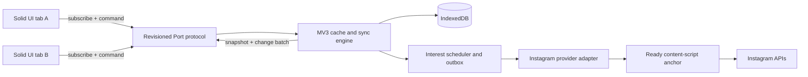
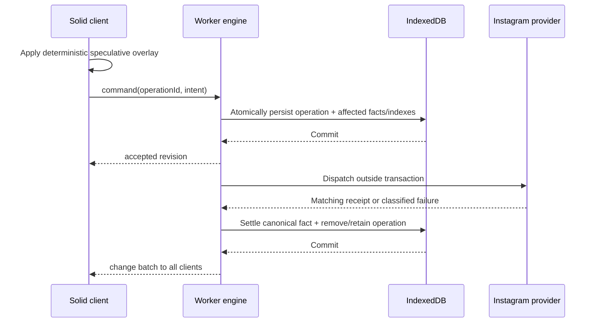
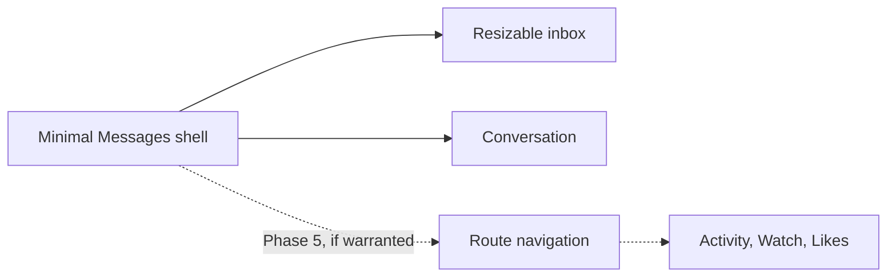

# Instagram Client code review and Solid 2 successor architecture

Date: 2026-09-10

**Status:** Proposed successor architecture; not implemented. Until a migration phase
lands and its documentation is updated, `docs/frontend-architecture.md` remains the
source of truth for the current implementation. Historical review scores below have
not been re-audited by this proposal.

## Executive verdict

The extension is **behaviorally strong but structurally at its limit**. Its protocol
parsing, normalization, optimistic reconciliation, bounded rendering, accessibility,
and regression coverage are substantially better than a typical prototype. The core
problem is not careless code: it is that production-scale cache, synchronization,
mutation, and lifecycle responsibilities accumulated inside one UI-tab store and one
UI module.

That ownership model cannot become the requested local-first client by incremental
polish. A cache-first proxy must survive UI closure, coordinate multiple clients,
persist accepted operations, recover after an MV3 worker restart, and broadcast one
canonical result. The current background is a stateless relay while each UI tab is its
own temporary authority.

**Recommendation:** preserve the Instagram provider/parsers and the proven interaction
behavior, but replace the UI-owned store with a worker-owned local-first engine backed
by IndexedDB. Rebuild the UI as a thin Solid 2 projection over that engine. Do not port
the existing 3,175-line store or 4,139-line component file line-for-line.

## Product goals and non-goals

The product goal is instant, cache-backed navigation that does not depend on the
latency or availability of a direct Instagram response. Reads have three tiers:

1. the in-memory subscribed or deliberately retained projection;
2. retained authorized data in IndexedDB;
3. a background provider refresh.

Interaction acknowledgement must occur in the same frame. On the fixed Phase 0
fixture, provisional targets are p95 at most 100 ms from navigation input to warm
route content, and 300 ms from UI entry execution to retained-cache content after a
cold worker reopen. These are targets, not measured results. The shell is never gated by anchor
readiness. Truly absent data, uncertain authentication, expired media URLs, and route
chunks that were not intent-preloaded cannot promise literal zero loading. Offline use
is limited to retained data whose account authorization can be established; media
bytes are not guaranteed offline.

The UI should feel native through Solid's fine-grained propagation, not a root
rerender compatibility loop. Ship a minimal responsive Messages UI first, with clear
component, projection/store, use-case service, repository, scheduler, and provider
ownership. Keep the implementation genuinely small: no premature navigation rail,
feature placeholders, generic sync framework, class hierarchy, or service framework
per entity.

Non-goals are a full Instagram mirror, an always-on MV3 process, a generic sync
platform, complete remote activity history, or guaranteed offline media bytes. Privacy
outweighs instant reopening of a prior account: automatically reopen a partition only
with trustworthy current local identity evidence. Otherwise offer explicit, labeled,
read-only offline account selection, and never send a command until provider identity
is verified. An undetected external account switch can leave old cached data visible;
the design reduces that risk but must not claim it is impossible.

### Current quality scorecard

| Area                                   |  Score | Assessment                                                                                                                                     |
| -------------------------------------- | -----: | ---------------------------------------------------------------------------------------------------------------------------------------------- |
| Instagram boundary and parsing         | 8.5/10 | Narrow capability surface, response checks, HAR-backed behavior, safe error redaction.                                                         |
| Correctness under overlapping requests | 8.5/10 | Extensive generation, receipt-revision, cursor, and single-flight handling.                                                                    |
| UI responsiveness                      |   8/10 | Optimistic actions, warmups, bounded lists, reserved media geometry.                                                                           |
| Accessibility and keyboard support     |   8/10 | Strong modal/focus/error semantics and unusually broad browser coverage.                                                                       |
| Test depth                             | 8.5/10 | 221 focused tests, including 64 browser tests; weak at worker lifecycle and multi-client boundaries because those boundaries do not exist yet. |
| State ownership                        |   4/10 | Correct normalization, wrong process and lifetime for a local-first application.                                                               |
| Modularity                             |   3/10 | `store.ts`, `App.tsx`, `styles.scss`, and the browser harness are change hotspots.                                                             |
| Persistence and offline behavior       |   2/10 | Pins and preferences persist; entities, indexes, freshness, and accepted operations do not.                                                    |
| Multi-client consistency               |   1/10 | Every UI tab owns an independent cache and polling loop.                                                                                       |
| Extensibility for watch/likes history  |   3/10 | Existing reel-local nesting and two-pane shell resist cross-feature views.                                                                     |

## Scope and weighting

Reviewed production code under `entrypoints/` and `lib/`, project configuration,
tests, architecture documentation, and the tracked `instant-gram/` experiment. Build
artifacts, dependency code, HAR bodies, and vendored Teact internals were excluded
except where their integration affects the application.

Weights use a 10-point priority score:

- impact: 1–5;
- likelihood/current frequency: 1–3;
- architectural reach: 1–2.

`10` means the successor should not ship without resolving it. `7–9` belongs in its
foundation. `4–6` should be handled during the relevant migration slice. `1–3` is
cleanup. “Risk” identifies a plausible failure; “defect” has a directly incorrect
boundary or configuration; “tradeoff” may be reasonable in the current MVP but should
be made explicit.

## Ranked findings

### P0 — successor blockers

#### 1. The UI tab is the authoritative data and synchronization process — weight 10/10

**Type:** architecture defect

`createFrontendStore` owns entities, indexes, cursors, retries, request registries,
receipt revisions, speculative queues, polling, and optimistic mutations
(`entrypoints/ui/store.ts:265-375`). `useStore` starts and destroys all of it with the
mounted UI (`entrypoints/ui/App.tsx:3711-3719`), and `destroy()` discards every
in-memory flight and reconciliation journal (`entrypoints/ui/store.ts:2850-2908`).

This is coherent for one ephemeral page, but fundamentally wrong for cached local
state. Closing or reloading the tab destroys authority. A second UI tab creates another
authority. Move canonical entities, resource indexes, sync, and mutation settlement to
the background worker. A Solid window should own only presentation and interaction
state.

#### 2. There is no durable entity cache or mutation outbox — weight 10/10

**Type:** missing capability

Only pins use extension storage (`entrypoints/background.ts:8-13,119-127`). Sidebar
width and reel volume use page `localStorage`; messages, media metadata, comments,
pagination indexes, freshness, optimistic sends, forwarding progress, edits, and
engagement mutations disappear with the UI.

The requested “return cached state instantly, then synchronize” contract requires
IndexedDB records for canonical entities, ordered resource indexes, sync metadata, and
accepted mutations. Persist operation intent before network dispatch. Do not persist
media bytes or proxied avatar data URLs.

#### 3. Multiple UI clients duplicate work and can diverge — weight 9/10

**Type:** correctness and efficiency risk

The browser action always creates another UI tab (`entrypoints/background.ts:102-106`).
Each tab starts its own store and five-second visible polling loop
(`entrypoints/ui/store.ts:369-375,842-919`). There is no subscription/fan-out channel,
shared read coalescing, or global mutation serialization beyond pin persistence.

The worker must be the single cache/sync authority and expose a revisioned
`runtime.Port` protocol. Durable deduplication uses `(accountId, operationId)` plus an
immutable payload: repeated delivery resolves to the same acceptance. Retain the
deduplication record through the supported command-redelivery window; reject reuse
of an operation ID with a different payload. There is one
live attempt per operation; an unknown result is reconciled or gated, not blindly
retried. This is not an upstream exactly-once guarantee, and distinct user commands
from two clients are not deduplicated merely because their payloads look alike.

#### 4. A cache-first read path does not exist — weight 9/10

**Type:** architecture gap

On every mount, `start()` calls live `loadInbox()` and `loadPins()`
(`entrypoints/ui/store.ts:2836-2848`). The background immediately forwards reads to an
Instagram tab (`entrypoints/background.ts:70-82`). Warm memory helps only during that
one UI lifetime.

Every resource needs explicit persisted state: cached value/index, `fetchedAt`,
freshness policy, current cursor, exhaustion, and last error. Active flights remain
ephemeral scheduler state. A query
must publish cached data first, schedule stale-while-revalidate second, and never blank
usable data during refresh.

#### 5. Several accepted mutations cannot safely survive an unknown outcome — weight 8/10

**Type:** correctness constraint

DM sends and forwards carry stable client IDs (`lib/domain.ts:409-427`), but reel
comment creation has no idempotency or reconciliation key (`lib/domain.ts:371-375`). A
worker restart or lost response after Instagram accepts a comment makes blind retry
capable of duplicating it.

The outbox must classify operations by retry safety. Persist every accepted intent;
automatically retry only idempotent or independently reconcilable commands. For non-idempotent comment
creation, preserve an “outcome unknown” item and require refresh/user resolution unless
Instagram evidence supplies a reliable client key.

#### 6. Account identity does not partition cached state — weight 8/10

**Type:** future privacy/correctness blocker

The current ephemeral cache avoids long-lived cross-account data mostly by accident.
Once persistence is introduced, every entity, resource index, event, and outbox record
must be scoped by the authenticated Instagram viewer ID. `viewerId` currently arrives
inside thread results (`lib/domain.ts:183-186`) rather than defining the storage
partition.

The provider must report an authenticated account identity to the worker. An identity
change increments the engine epoch, switches partitions, cancels obsolete scheduling,
and tells clients to reset their projections. Never merge records across viewers.

### P1 — foundation and major maintainability

#### 7. `store.ts` is a hand-built database, scheduler, reducer, and use-case layer — weight 8/10

**Type:** maintainability risk

`entrypoints/ui/store.ts` is 3,175 lines. Its setup alone contains more than 35 mutable
registries/counters (`:283-355`), while reel reconciliation (`:429-531`), inbox and
incoming merging (`:589-919`), mutations, pagination, navigation, and public UI actions
share one closure.

The logic is often careful, but local reasoning is expensive because canonical state
and side metadata can change independently. Split by ownership, not arbitrary file
size: repositories transact persisted facts; reducers merge server facts; the outbox
owns optimistic overlays; the scheduler owns flights/priorities; feature services own
use cases. Keep one engine, not one file.

#### 8. `App.tsx` combines the entire product with low-level DOM protocols — weight 8/10

**Type:** maintainability risk

`entrypoints/ui/App.tsx` is 4,139 lines and contains the shell, list rows, history
anchoring, composer, context menus, reaction picker, forwarding, media modal, two media
players, global shortcuts, formatters, and accessibility derivation. `MessagePane`
alone coordinates timers, observers, anchor snapshots, pagination, following, reply
navigation, and composition (`:567-1059` and beyond).

Port behavior into feature modules with a deliberate DOM ownership boundary. A
`MessageViewport` controller may remain complex, because scroll anchoring is genuinely
complex, but media, forwarding, menus, keyboard routing, and formatting should not be
in the same compilation/change unit.

#### 9. Every store emission rerenders the application root — weight 7/10

**Type:** performance and coupling risk

`useStore` increments a root-local version on any store event
(`entrypoints/ui/App.tsx:3711-3719`). Components then read mutable `store.state`
directly. Teact `memo` limits some downstream work, but a comment mutation, poll state,
or toast still starts reconciliation from the root.

Solid should hold a normalized projection in `createStore` and update only touched
entities/indexes with draft setters and `reconcile`. Components read fine-grained paths
and lists use stable `<For>` keys. Do not reproduce the external mutable store plus
force-render counter.

#### 10. Canonical data and control metadata are split across mutable side registries — weight 7/10

**Type:** correctness and auditability risk

Examples include `reactionStateRevisions`, reel receipt revisions,
`messageEditReceipts`, read watermarks, request maps, and queues
(`entrypoints/ui/store.ts:299-350`). They correctly protect current races but cannot be
inspected, persisted, migrated, or transactionally committed with entity updates.

In the successor, durable mutation overlays and receipt metadata belong beside the
outbox transaction. Ephemeral flight state belongs to the scheduler and must be
reconstructible. Use pure merge functions so overlapping-read cases remain directly
testable.

#### 11. Incoming synchronization is UI-visible polling — weight 7/10

**Type:** deliberate MVP tradeoff

The visible tab polls inbox and optionally selected history every five seconds with
backoff (`entrypoints/ui/store.ts:827-919`). It is lifecycle-aware and shares current
flights, which is good, but it creates redundant authenticated traffic per UI tab and
stops when no UI document exists.

Keep polling as a fallback, but move it to the worker interest scheduler. Poll once
while one or more visible clients subscribe; stop high-frequency polling without
interest. Prefer a proven page-context live-update feed later, with polling retained as
repair, not as two simultaneous authorities.

#### 12. Media and engagement entities are normalized only inside a reel feature island — weight 7/10

**Type:** extensibility risk

`ReelState` nests media, top-level comment IDs, comment entities, child indexes,
drafts, and like mutations (`entrypoints/ui/store.ts:147-172`). This works for one modal
but makes the same media/comment/user difficult to reuse in likes history, saved media,
watch history, search, or notifications.

Normalize global facts by stable identity: `mediaById`, `mediaIdByShortcode`,
`commentsById`, `usersById`. Keep ordered query results in resource indexes such as
`mediaComments:<mediaId>` and `commentReplies:<commentId>`. Keep drafts and active slide
in client-local UI state.

#### 13. Transport failures are flattened to strings — weight 7/10

**Type:** sync-engine blocker

`ApiError` contains only `message` (`lib/domain.ts:199-200`), and the content boundary
turns all failures into that envelope (`entrypoints/ig-anchor.content.ts:91-104,410-415`).
The current UI can show Retry, but a durable engine cannot distinguish offline,
authentication, rate limiting, stale query documents, invalid input, unknown mutation
outcome, or permanent protocol mismatch.

Introduce a small stable error taxonomy at the provider boundary, for example
`offline | auth | rate_limited | stale_operation | invalid_request | protocol |
unknown_outcome`. Preserve a redacted human message and optional retry time. Do not
expose raw Instagram payloads or tokens.

#### 14. Anchor-tab readiness is assumed — weight 7/10

**Type:** concrete reliability risk

`ensureAnchorTab()` returns the first matching tab or newly created tab immediately
(`entrypoints/background.ts:15-33`), while the content script registers handlers at
`document_idle` (`entrypoints/ig-anchor.content.ts:389-417`). A request can be sent
before the listener exists, especially after creating or restoring a tab.

Add a provider readiness handshake keyed by tab/navigation. Wait for the content
script’s ready message before dispatch. Invalidate readiness on navigation/removal and
surface a classified auth/provider-unavailable error rather than relying on bridge
failure timing.

#### 15. The RPC capability registry is repeated and type safety is cast away — weight 6/10

**Type:** maintainability risk

RPC names are manually repeated in `lib/domain.ts:352-462`,
`entrypoints/background.ts:52-67`, `entrypoints/ig-anchor.content.ts:31-48`, and
`entrypoints/ui/rpc.ts:25-42`. `as never` bridges generic mismatches at each hop
(`background.ts:78-82,112`; `ui/rpc.ts:21-22`; `main.tsx:12`).

Define one typed operation descriptor registry that derives names, payload/result
types, provider routing, and validation ownership. Do not build a generic “execute any
GraphQL” UI escape hatch. Keep the closed capability list.

#### 16. Request cancellation is logical, not physical — weight 6/10

**Type:** resource tradeoff

Generation checks correctly ignore stale completions, but `destroy()` only clears
registries (`entrypoints/ui/store.ts:2850-2908`); provider fetches continue. Rapid
selection, prefetch invalidation, account changes, or worker shutdown can spend scarce
Instagram requests on results no client needs.

Use `AbortController` through engine-to-provider calls where the transport permits it.
Do not cancel shared reads while another subscriber remains. Idempotent stale-result
rejection is still required because cancellation is best-effort.

#### 17. Persistence has no schema/version/retention design — weight 6/10

**Type:** required design work

This is absent because current data is ephemeral. A successor that simply dumps the
store into IndexedDB will grow without bound and strand incompatible records.

Version the database and every projection epoch. Retain all lightweight thread
metadata, bounded recent history resources, bounded media metadata, explicit user
activity history, and pending/failed outbox records. Evict stale query indexes and
unreferenced entities by measured limits. Never evict unsettled operations.

### P2 — important migration cleanup

#### 18. Auth harvesting repeatedly scans large page content — weight 6/10

**Type:** performance and fragility tradeoff

`pageJson()` recursively searches embedded JSON and `pageText()` materializes the
entire document HTML plus every script (`lib/ig-auth.ts:57-79`). Token caching limits
frequency to 60 seconds, and the MAIN-world probe is a useful preferred path, but the
fallback can allocate and scan a large Instagram page.

Keep the probe as the primary provider contract. Limit fallback harvesting to known,
measured sources and run broad scanning only after those fail. Record which source
worked for diagnostics without storing token values.

#### 19. The auth event listener lets malformed page events throw — weight 5/10

**Type:** boundary defect

`startAuthProbeListener()` parses any matching window event without catching validation
errors (`lib/ig-auth.ts:192-203`). Instagram-page code can emit malformed details and
trigger an uncaught listener exception. Same-page spoofing is not a privilege escalation
because the page already owns its session, but malformed events should not destabilize
the provider.

Catch parse failures at this external event boundary, ignore invalid/stale timestamps,
and replace probe state only after complete validation. Add a focused regression test.

#### 20. Pin persistence trusts an unchecked cast — weight 5/10

**Type:** persistence-boundary defect

`getPinned()` casts storage data to `PinStore` and returns `stored.pinned` unchanged
(`entrypoints/background.ts:8-13`). Corrupt, migrated, or manually modified storage can
reach array operations that assume strings.

Validate that the value is an array of non-empty strings and deduplicate at the
repository boundary. The IndexedDB successor should validate/migrate every durable
record on schema upgrade, not on every component read.

#### 21. The repository-wide structural scan is already red — weight 5/10

**Type:** quality-gate defect

The required shared ast-grep scan reports two error-level `no-import-alias`
violations at `lib/instagram-api/catalog.ts:4` and
`entrypoints/ui/instagram-api-catalog.test.ts:5`, plus numerous warnings around unsafe
assertions, broad dictionaries, and unparsed `unknown` boundaries. The current
TypeScript check does not represent the full configured quality policy.

Fix the two errors immediately, then ratchet warnings by touched module during the
migration. Do not turn the successor into a bulk lint-cleanup rewrite, but require every
new engine/Solid module to pass the shared scan without new diagnostics.

#### 22. Configuration contains a machine-specific browser path — weight 4/10

**Type:** portability defect

`wxt.config.ts:14-17` hard-codes Helium under `/Applications`. It does not affect the
production bundle, but it makes local development configuration surprising and
non-portable.

Read an optional environment variable or keep personal browser selection outside the
tracked project config.

#### 23. CDN host permission is broader than the implementation — weight 4/10

**Type:** least-privilege defect

The manifest grants `*://*.cdninstagram.com/*` (`wxt.config.ts:21-24`) while the media
proxy correctly rejects everything except HTTPS (`lib/media-proxy.ts:7-16`). Restrict
the manifest permission to `https://*.cdninstagram.com/*`.

#### 24. Global module state leaks ownership across potential roots — weight 4/10

**Type:** maintainability risk

Keyboard sequence and modal return-focus elements are module globals
(`entrypoints/ui/App.tsx:49-51`). One UI root currently makes this work, but it obscures
lifetime and complicates isolated tests or future embedded surfaces.

Move these into an application-scoped interaction controller/context with teardown.
Solid context should carry controller services; entity state still belongs to the
worker projection.

#### 25. Preferences use page `localStorage`, separate from extension persistence — weight 4/10

**Type:** product tradeoff

Sidebar and volume helpers use UI-origin `localStorage`. This is synchronous and cheap,
but does not participate in extension-level schema, account/global policy, migration,
or cross-tab updates.

Use `storage.local` for small global settings and broadcast updates through the engine.
Keep per-tab ephemeral geometry in memory. Do not put high-volume entities in
`storage.local`.

#### 26. Styling is a single 2,868-line global sheet — weight 4/10

**Type:** maintainability risk

`entrypoints/ui/styles.scss` mixes tokens, shell, history, floating surfaces, composer,
media, comments, responsive layouts, and animation. The rules are generally disciplined
and reduced motion is handled (`:2853-2867`), but feature changes have a broad cascade
surface.

Retain one token/theme entrypoint and split feature partials. Prefer component-root
class namespaces, CSS custom properties for runtime geometry, container queries for
pane components, and logical properties. Avoid runtime CSS-in-JS.

#### 27. The shell is message-first rather than product-extensible — weight 4/10

**Type:** intentional MVP limitation

The UI is a two-column inbox/conversation grid (`styles.scss:94-105`) with a compact
one-pane breakpoint (`:2557-2587`). That is effective for DMs but leaves no stable
information architecture for watch history, likes history, saved media, sync health,
or settings.

Preserve the simple Messages shell first. Add a lightweight route rail only when
multiple shipped destinations justify it; do not reserve empty Watch, Likes, or
Activity navigation before Phase 5.

#### 28. Test setup performs browser installation on every `npm test` — weight 3/10

**Type:** tooling inefficiency

`package.json:11-12` runs `playwright install chromium` as `pretest`, while CI already
installs Chromium with system dependencies (`.github/workflows/ci.yml:23-26`). This
makes ordinary test runs slower and network-dependent.

Move installation to an explicit bootstrap command and CI. Keep `npm test` hermetic
after dependencies/browsers are installed.

#### 29. Documentation contains historical statements presented as current — weight 3/10

**Type:** documentation drift

`docs/frontend-rewrite-plan.md:122` says no browser harness exists, but
`entrypoints/ui/history.browser.test.ts` is a 3,796-line Playwright suite. Other
milestone-era wording conflicts with the much newer architecture document.

Mark the rewrite plan as historical and make this successor document plus a concise
engine contract the current source of truth.

#### 30. The browser suite is comprehensive but itself a monolith — weight 3/10

**Type:** test maintainability risk

`history.browser.test.ts` contains 64 tests across shell, resize, media, modal focus,
history anchoring, composer, menus, keyboard controls, forwarding, and incoming sync.
Coverage is excellent; failure diagnosis and selective execution will degrade as more
features arrive.

Split by product boundary while sharing one small harness: `inbox`, `history`,
`composer`, `media`, `surfaces`, and `keyboard`. Add worker protocol suites separately;
do not replace browser behavior tests with component snapshots.

#### 31. The tracked `instant-gram/` project is an ambiguous second application — weight 3/10

**Type:** repository hygiene risk

It has its own package manager lock, router, app shell, tests, Solid RC dependencies,
and generic example content (`instant-gram/package.json`, `instant-gram/src/App.tsx`). It
is not wired into the extension build and currently looks like a starter experiment.

Either delete it before migration or rename/document it as a disposable spike. Do not
evolve a separate routed web app and the WXT extension in parallel. Reuse only verified
Solid 2 setup knowledge, not its example architecture.

## What should be preserved

The successor should not throw away the strongest current work:

1. **Closed Instagram capability boundary.** Components do not know document IDs,
   cookies, or response aliases. Keep `lib/instagram-api/catalog.ts`, handlers, and
   parsers behind a provider adapter.
2. **Normalized ordered indexes.** The `orderedIds`/`listedIds` plus `byId` model and
   overlap deduplication are correct.
3. **Opaque cursor handling and failure gates.** Keep exact cursor ownership, no-progress
   detection, explicit retries, and one flight per resource/cursor.
4. **Receipt identity validation.** A “successful” response is not accepted unless it
   matches the requested target and final state.
5. **Optimistic local/server row identity.** Preserve stable client IDs and the local to
   server message-key bridge.
6. **Bounded rendering.** Preserve fixed 72px inbox rows, overscan, at most 80 mounted
   history messages, and local-window movement before network pagination.
7. **Scroll anchoring.** Preserve ID-plus-offset anchors, layout-phase correction, and
   `ResizeObserver` correction for media growth.
8. **Intent-ranked prefetch.** Explicit action outranks near-viewport work, which
   outranks speculation; all can join an existing flight.
9. **Accessibility.** Preserve semantic controls, retry/status announcements, focus
   containment/restoration, keyboard navigation, and reduced motion.
10. **Security boundaries.** Preserve HTTPS-only bounded avatar proxying, response
    parsing outside the UI, error redaction, and the Telegram GPL clean-room boundary.

## Target architecture

The cache engine is a local server. The Solid application is one of potentially many
clients, not the owner of server state.



### Ownership matrix

| Layer                             | Owns                                                                                                                     | Must not own                                     |
| --------------------------------- | ------------------------------------------------------------------------------------------------------------------------ | ------------------------------------------------ |
| Instagram provider/content script | Auth extraction, request descriptors, network calls, external payload validation, protocol error classification          | Cache freshness, UI state, optimistic policy     |
| Worker repositories               | IndexedDB schema, migrations, transactions, normalized facts and indexes                                                 | DOM state, request prioritization                |
| Worker engine                     | Cache-first queries, command acceptance, merge reducers, overlays, outbox, account epoch, subscriptions                  | DOM geometry, component state                    |
| Worker scheduler                  | Read coalescing, priorities, backoff, visibility/interest policy, safe retry, cancellation                               | Entity shape interpretation                      |
| Solid projection client           | Connection/reconnect, bounded local replica, subscription generations/sequences, synchronous speculative command overlay | Instagram calls, cursor policy, canonical merges |
| Solid feature UI                  | Selection, routes, drafts, scroll/focus, open surfaces, media element state                                              | Canonical entities, retries, persistence         |

### Proposed source layout

```text
entrypoints/
  background.ts                 worker bootstrap only
  ig-anchor.content.ts          provider registration only
  ui/
    main.tsx
    app/App.tsx
    app/routes.ts
    client/projection-client.ts
    client/command-overlay.ts
    features/inbox/
    features/history/
    features/composer/
    features/media/
    features/settings/
    styles/_tokens.scss
    styles/_shell.scss
lib/
  domain/                       protocol-neutral entities and commands
  instagram-api/               current catalog, handlers, parsers
  provider/                     typed worker-to-anchor adapter
  engine/
    db.ts                       schema and migrations
    repositories.ts             transactional persistence
    resources.ts                indexes, cursors, freshness
    reducers.ts                 pure server-fact merges
    outbox.ts                   optimistic overlays and settlement
    scheduler.ts                flights, interest, priority, backoff
    subscriptions.ts            snapshots and revisioned change batches
```

This is a target map, not a demand for one file per noun. Combine files while modules
remain cohesive; split only at real ownership boundaries.

## Storage model

Use native IndexedDB. The problem needs transactions and indexes, not a general client
query library.

### Durable stores

| Store            | Key                       | Important fields                                                                  |
| ---------------- | ------------------------- | --------------------------------------------------------------------------------- |
| `accounts`       | `accountId`               | schema metadata, last seen, active partition marker                               |
| `users`          | `[accountId,id]`          | normalized profile facts                                                          |
| `threads`        | `[accountId,id]`          | normalized thread facts and latest-message reference                              |
| `messages`       | `[accountId,id]`          | normalized message facts; client/server alias metadata                            |
| `media`          | `[accountId,id]`          | shortcode, author ID, media item metadata, engagement facts                       |
| `comments`       | `[accountId,id]`          | author ID, parent IDs, text and engagement facts                                  |
| `resources`      | `[accountId,key]`         | ordered IDs, cursor, exhausted flag, fetched time, error metadata                 |
| `operations`     | `[accountId,operationId]` | immutable command payload, target, overlay, status, attempts, retry safety, error |
| `activityEvents` | `[accountId,eventId]`     | local watch/like/save/comment events and reconciliation status                    |

Resource keys are explicit and protocol-neutral, for example `inbox:primary`,
`history:<threadId>`, `comments:<mediaId>`, and `commentReplies:<commentId>`. Cursors
remain opaque strings. Entity stores hold facts; resources hold ordering and pagination.
All listed stores are account-partitioned. Intentional global preferences are excluded
from that invariant: `storage.local` is their sole authority, not a duplicate IndexedDB
settings row.

### Canonical facts versus optimistic overlays

Never mutate the last known server fact and hope to reconstruct rollback later. Store:

- canonical server fact;
- zero or more ordered pending operation overlays;
- a projected value derived for delivery to clients, not another persisted fact copy.

On every read or receipt, replace/merge canonical facts, then replay still-applicable
overlays. This turns the current feature-specific rollback maps into one testable rule
while retaining field-specific reducers for reactions, likes, saves, edits, pins, and
message identity.

### Transaction rule

An accepted command is durable before dispatch:



The speculative UI overlay exists only to meet same-frame interaction latency. It uses
the same pure command projector as the worker and is replaced by the worker’s accepted
revision. Components still do not own parallel caches. If worker validation rejects the
command, the projection removes the speculation and exposes the classified error.
Every accepted intent, including an unsafe operation, is durable. Only safe or
independently reconcilable operations are automatically retried. Active flights are
ephemeral scheduler state and are never persisted. Conflicting mutations serialize per
target; unrelated targets and reads do not pass through one global queue. No network
request is held open inside an IndexedDB transaction.

## Cache and synchronization semantics

### Query contract

Every resource reports three independent dimensions:

- availability: `absent | present` (where present can be known-empty);
- freshness: `fresh | stale`;
- synchronization: `idle | queued | refreshing | error`.

Thus a failure and usable cached data can coexist. `subscribe(resourceKey)` produces:

1. a persisted snapshot as soon as the worker hydrates;
2. the three-dimensional resource metadata;
3. a background refresh when absent/stale or explicitly requested;
4. normalized change batches after an atomic commit.

“Refreshing” never replaces cached content with a spinner. Initial loading UI exists
only for a truly absent cache. Errors remain attached to stale content with an explicit
retry affordance.

### Freshness is policy, not one global TTL

- inbox and active history: short stale window while a visible client is interested;
- older history pages: immutable-ish and refreshed only on evidence or explicit repair;
- media signed URLs: metadata may be cached, but source expiry/failure triggers forced
  refresh;
- comments and engagement counts: short-lived while the media surface is open;
- settings and local activity: local authority, no Instagram refresh;
- mutation targets: refresh/receipt rules override TTL.

Do not invent exact intervals before measuring API behavior. Store policy names and
centralize their current values in scheduler configuration.

### Interest and prefetch

Clients report route, visibility, selected thread, near-viewport reply targets, and
near-viewport media IDs. The worker computes work priority:

1. accepted user command;
2. explicit query/open/retry;
3. visible missing resource;
4. near-viewport resource;
5. one adjacent history page;
6. bounded likely-next-chat/media speculation.

Keep current budgets initially: two concurrent media reads, two likely chat warmups,
one adjacent older-history preload, four reply-prefetch targets, and at most 80 mounted
history rows. Measure before broadening them.

### Worker restart and client revisions

Worker memory is disposable. Each entrypoint registers listeners synchronously, then
awaits one `engine.ready()` promise inside request handling. Startup hydrates only the
bounded resources needed to serve subscriptions and scheduling, not the entire
database. Ports help while clients are open but are not persistence. `chrome.alarms`
may wake safe outbox retries or coarse refresh work; it must not emulate a permanent
five-second process.

Identity has an `accountId` and account epoch; each worker lifetime has a separate
worker epoch. Every database commit has a monotonic global `commitRevision`, while each
client subscription (the union of its resource interests) has its own generation and
contiguous sequence. Scoped clients must not
treat commits irrelevant to their subscriptions as gaps.

A subscribed snapshot is read at a `commitRevision`, then followed by committed changes
buffered during the snapshot race. Overlapping resource interests produce one coherent
typed upsert/delete/resource batch per client. Clients ignore duplicate sequences; an
actual sequence gap, reconnect, worker epoch, account epoch, or subscription-generation
change requests a fresh subscribed snapshot. Do not add a durable replay log by default.

Subscriptions plus a small set of likely-next resources bound the projection and
worker memory. Releasing interest permits projection eviction; retained IndexedDB data
has separate measured retention limits. A mount bound alone is not a cache bound.

## Backend composition and Effect decision

Compose feature use cases at worker bootstrap with explicit dependencies. For example,
`ConversationService` reads history and accepts sends; `MediaService` owns media and
engagement use cases. Small functional factories receive repositories, provider, and
scheduler, and call pure reducers. Do not introduce a class hierarchy, event bus,
generic service framework, or one service abstraction per entity.

Plain typed TypeScript is the default. Phase 0 or 1 may run one bounded, worker-only
Effect comparison if it demonstrably removes async plumbing already required by this
engine. Evaluate structured concurrency, cancellation, and typed errors against
dependency bytes, worker cold-start cost, and team cost. If selected, assemble one
runtime at the worker boundary; Effect must not become a frontend dependency or share
state ownership with Solid. Fibers and finalizers do not make MV3 durable: IndexedDB,
outbox, identity, retry-safety, and alarm rules remain authoritative. Effect adoption
is not assumed.

## Solid 2 application design

Use coordinated Solid 2, `@solidjs/web`, compiler, and Vite plugin versions. The
tracked experiment currently pins RC packages independently (`instant-gram/package.json`);
verify compiler/runtime integration in the WXT extension build before migration.

### Required conventions

- import reactivity and stores from `solid-js`, DOM rendering from `@solidjs/web`;
- configure `"jsx": "preserve"` and `"jsxImportSource": "@solidjs/web"`;
- use `createSignal` for primitive UI values and `createStore` for the normalized
  projection;
- update stores through draft setters and select entity records by stable ID;
- use `<For>`, `<Show>`, `Loading`, and `Errored` with deliberate keyed/positional
  semantics;
- keep props intact; do not destructure reactive props;
- put reactive reads in the compute callback of `createEffect` and imperative DOM,
  port, or media work in its apply callback;
- use `onSettled` for post-initial-graph setup and `flush()` only at imperative/test
  boundaries that require synchronous observation.

Do not introduce removed Solid 1 APIs: `createResource`, `batch`, `startTransition`,
`useTransition`, `on`, `createComputed`, `produce`, `createMutable`, `onMount`,
`Suspense`, `ErrorBoundary`, or `Index`. Do not import from `solid-js/store` or
`solid-js/web`.

Projection reads are synchronous. An async memo must not fetch Instagram data, and a
query library must not create a parallel cache. `Loading` and `Errored` represent only
genuinely missing data or route-chunk failure, never a cached background refresh. For a
stable ID array use `<For>` and select each entity by ID; do not assume React's `key`
contract or run `reconcile(..., "id")` over strings.

Each client context exposes read-only projection access and domain command methods.
Use derived selectors and memos rather than mirrored effect state, and clean up ports,
resource interests, and DOM/media controllers with their owner.

### Projection shape

```ts
type ClientProjection = {
    accountId: string;
    accountEpoch: string;
    workerEpoch: string;
    subscriptionGeneration: number;
    sequence: number;
    commitRevision: number;
    entities: {
        users: Record<string, User>;
        threads: Record<string, Thread>;
        messages: Record<string, Message>;
        media: Record<string, ReelMedia>;
        comments: Record<string, ReelComment>;
    };
    resources: Record<string, ResourceProjection>;
    operations: Record<string, OperationProjection>;
};

type UiState = {
    route: AppRoute;
    historyViewportIdsByThread: Record<string, string[]>;
    scrollAnchorsByThread: Record<string, { id: string; offset: number }>;
    draftsByThread: Record<string, string>;
    activeDialog?: DialogIntent;
};
```

The first object is a replica of worker-owned data. The second is per-window interaction
state. Cursor, retry, freshness, and optimistic settlement state do not belong in
`UiState`. Route parameters are canonical selection. `historyViewportIdsByThread` is
only a bounded derived render window, never another cache.

### Component boundaries

- `AppShell`: minimal Messages workspace and global notifications;
- `NavigationRail`: optional, only after multiple destinations ship;
- `InboxRoute`: virtualized thread index plus conversation detail;
- `MessageViewport`: bounded IDs, scroll anchor controller, near-viewport reporting;
- `Composer`: local draft/reply/edit intent and engine commands;
- `MediaRoute`/`MediaDialog`: normalized media projection and native player controller;
- `ActivityRoute`: deferred Phase 5 event queries, filters, and retention controls;
- `SyncStatus`: honest offline/auth/refresh/outbox state without modal interruption.

Keep DOM-heavy controllers near their elements. A dedicated history viewport module is
better than a generic virtualization framework because current fixed-list and
variable-history invariants differ.

## Layout successor

Keep the message-first two-pane desktop shell and compact one-pane behavior. A route
navigation zone is optional and appears only after multiple destinations ship.



### Desktop

- Messages retains resizable thread list and flexible conversation pane;
- no empty placeholder destinations; Phase 5 may add bounded activity/history layouts;
- global search/command entry belongs in the active route, not a permanently heavy
  header;
- sync/offline state is a quiet rail/header indicator with an accessible detail view.

### Compact

- one pane at a time with real route/history state, not CSS-only hiding;
- bottom or compact top navigation only when multiple features have shipped;
- opening a thread/media item pushes detail state and Back restores the exact list
  window and focus target;
- dialogs become full-screen sheets only when the content requires them.

### Responsiveness and lightness budgets

- no runtime CSS-in-JS or general virtualization dependency;
- route-level dynamic imports for media/activity features, with inbox shell kept eager;
- at most roughly 31 inbox rows and 80 message rows mounted;
- activity/history lists must also declare a mount bound before implementation;
- reserve all media geometry and animate only transform/opacity;
- all input acknowledgement in the same animation frame;
- cached navigation should require no loading takeover;
- no main-thread task above 50 ms for 1,000 cached IDs;
- production UI increase should be pre-budgeted; target no more than 15 KiB gzip above
  the current bundle unless a measured feature justifies it.

Intent preloading covers both the needed route chunk and bounded data interests, so a
successful warm navigation waits on neither a Port round trip nor chunk fetch. Keep a
small likely-next retention budget; do not preload every route.

## Watch history and likes history

These are not merely new arrays on `ReelState`. Model them as local activity facts so
they survive UI/worker restarts and can be queried independently of current media cache
retention.

### Watch events

Record a session when playback starts after explicit user intent or meaningful visible
autoplay. Periodically coalesce checkpoints rather than writing every `timeupdate`:

```ts
type WatchSession = {
    id: string;
    accountId: string;
    mediaId: string;
    startedAtMs: number;
    lastViewedAtMs: number;
    watchedMs: number;
    lastPositionSec: number;
    durationSec?: number;
    completed: boolean;
};
```

Use one active session per client/player and flush on pause, item change, visibility
loss, dialog close, and periodic bounded checkpoints. Store metadata references, not
video bytes. Define retention and a clear-history action before shipping.

### Engagement events

Likes history should distinguish local intent from current Instagram state:

```ts
type EngagementEvent = {
    id: string;
    accountId: string;
    target: { kind: 'media' | 'comment' | 'message'; id: string };
    action: 'liked' | 'unliked' | 'saved' | 'unsaved' | 'reacted' | 'unreacted';
    occurredAtMs: number;
    operationId?: string;
    status: 'local' | 'confirmed' | 'failed' | 'observed_remote';
};
```

The UI can show “likes performed through this extension” with certainty. It must not
claim complete Instagram account history unless a captured authoritative API proves
that scope. Reconciliation may append `observed_remote` state changes, but should not
fabricate an event timestamp from a snapshot that has none.

## Migration plan

### Phase 0 — freeze contracts and measurements

1. Mark `instant-gram/` as spike or remove it.
2. Capture current production gzip sizes, mounted-row counts, anchor drift, warm-cache
   navigation latency, and mutation acknowledgement latency.
3. Keep current parser/store/browser tests as parity specifications.
4. Add tests for anchor readiness and malformed auth events before moving boundaries.
5. Prove coordinated Solid runtime/compiler integration in the WXT extension build;
   SSR is explicitly out of scope.

**Exit:** reproducible behavioral baseline and explicit size/performance budgets.

### Phase 1 — build the worker engine behind the current UI

1. Add account identity, IndexedDB schema/migrations, normalized repositories, resource
   metadata, and engine hydration.
2. Add the Port protocol foundation. A temporary Teact adapter must receive both an
   initial cached snapshot and subscription updates; preserving one-shot RPC alone is
   insufficient. It may update its view projection but must not own a second reducer.
3. Move read ownership one resource/use case at a time, disabling the legacy merge,
   poll, cursor, retry, and prefetch authority as each handoff occurs.
4. Add one worker-level flight per resource/cursor and provider readiness handshake.
5. Test cold worker start, cached response, stale refresh, account switch, no-progress
   cursor, and worker restart.

Read ownership cannot move independently of writes to the same facts. Start with a
read-only development slice, then bring forward the necessary Phase 2 mutation
handoff before releasing that resource to production. Never let a legacy mutation
settle into a worker-owned resource through an independent UI merge.

**Exit:** the existing Teact UI already renders persisted inbox/history before a live
Instagram response.

### Phase 2 — move mutations and synchronization

1. Implement durable operation records and pure overlay reducers.
2. Cut mutation families over atomically: move pins, send, edit, reactions, read
   receipts, forwarding, media like/save, and comment like into the engine while
   disabling each corresponding legacy acceptance/merge/retry path.
3. Classify comment creation as non-idempotent until evidence improves its contract.
4. Complete polling, prefetch, priorities, and fan-out for the remaining resources;
   already migrated resources have used worker scheduling since Phase 1.

**Exit:** two current UI tabs cannot duplicate a command or read flight; accepted safe
operations survive worker termination.

### Phase 3 — introduce the Solid projection and shell

1. Replace Teact/WXT TSX wiring with coordinated Solid 2 packages.
2. Replace the temporary Teact projection adapter with the Solid Port projection client
   and speculative command overlay; do not defer protocol design to this phase.
3. Build the minimal Messages shell, inbox virtualization, cached thread selection,
   initial history, and existing scroll-controller parity. Do not wholesale-port the
   old store.
4. Keep Teact UI available only behind a development flag during parity work; never
   let both clients issue production mutations simultaneously.

**Exit:** inbox, pinning, selection, initial/older history, send, read, and cache-first
restart behavior pass parity and multi-client tests.

### Phase 4 — port interaction-heavy features

1. Complete bounded viewport and anchor edge-case parity begun with initial history.
2. Port replies, editing, reactions, forwarding, menus, keyboard navigation, and focus.
3. Port reel/post cache projection, comments, carousel, player, prefetch, and media
   retry.
4. Split browser suites by feature while retaining all current assertions.

**Exit:** all current functionality and accessibility behavior pass in Solid; Teact is
no longer loaded.

### Phase 5 — activity features and cleanup

1. Add watch-session and engagement-event repositories and routes.
2. Add retention/export/clear controls and honest source labels.
3. Remove legacy UI store, Teact aliases, React type dependency, and vendored runtime
   only after no import remains; retain required MIT provenance in history/notices as
   appropriate.
4. Update README and make engine/projection contracts the architecture source of truth.

**Exit:** one production authority, one UI runtime, bounded storage, and measured
performance within budget.

## Required invariants

1. The worker is the sole canonical owner of entities, resources, cursors, sync, and
   mutation settlement.
2. All account data and protocol epochs are account-partitioned; intentional global
   preferences live only in `storage.local`.
3. UI projections are disposable replicas; UI-only state cannot change canonical facts.
4. Every entity is normalized; every ordered resource contains stable IDs only.
5. One read flight exists per account/resource/cursor; clients join it.
6. Every accepted intent is persisted before dispatch; only safe or independently
   reconcilable operations are automatically replayed after worker restart.
7. Unknown outcomes are never blindly retried when the upstream operation is not
   idempotent.
8. Server receipts must match target identity and requested final state.
9. Pending overlays are replayed over new canonical reads; stale reads cannot regress
   accepted intent.
10. A new account/worker epoch or actual subscription-sequence gap resets the client
    from a subscribed snapshot; irrelevant global commits do not create gaps.
11. Cached content remains visible during refresh and recoverable errors.
12. Components never contain Instagram documents, cookies, aliases, or cursor policy.
13. Inbox/history/activity rendering is bounded and uses stable domain keys.
14. Scroll, focus, drafts, dialogs, and native media element state remain per client.
15. No Telegram Web A source, styles, icons, or assets cross the GPL clean-room boundary.

## Acceptance criteria

### Correctness

- terminate the worker during a cached read, optimistic send, failed send, like, and
  prefetch; restart produces the defined state without duplication;
- two UI tabs observe one optimistic operation and one settlement while instrumentation
  records one provider mutation;
- overlapping pages and stale reads preserve canonical ordering, cursor continuity,
  receipt-backed fields, and client/server message identity;
- a detected account change clears the prior projection, rejects old-epoch completions,
  and prevents dispatch against a different provider identity;
- identity tests cover trusted automatic reopen and explicit labeled read-only offline
  account selection; they do not claim an undetected provider account switch can expose
  zero old data;
- scoped streams ignore unrelated commits without false gaps; actual gaps recover via
  snapshots, and an atomic snapshot-race test loses no committed update;
- duplicate `(accountId, operationId, immutable payload)` delivery returns the same
  acceptance, while separate client commands remain distinct;
- an unsafe operation with unknown provider outcome is retained and never blindly
  retried; conflicting targets serialize without globally serializing unrelated work;
- quota/write failure rejects command acceptance and records no provider dispatch;
- every retryable operation has a documented idempotency/reconciliation argument.

### Responsiveness

- click/keyboard feedback and speculative optimistic projection occur in the same frame;
- provider-blocked warm navigation paints when intent-preloaded code/data are ready,
  without a Port round trip or Instagram response;
- cached worker reopen and a true cache miss are measured and asserted separately;
- on the fixed Phase 0 fixture, provisional p95 is at most 100 ms from navigation input
  to warm route content and 300 ms from UI entry execution to retained-cache content
  after cold-worker reopen; these remain targets until baseline results exist;
- stale refresh never blanks cached data;
- 1,000 cached IDs merge/window without a task over 50 ms;
- older prepend anchor drift remains below 1 px;
- mounted-node bounds are asserted for inbox, message history, and future activity lists.
- two clients observe an update through only touched Solid projection paths, and an
  unrelated row remains mounted;
- projection resources, worker memory, and retained IndexedDB cache each have measured
  bounds and eviction tests;

### Quality and operations

- pure tests cover reducers, schema migrations, outbox restart, account reset, scheduler
  priority, revision gaps, and unsafe retry gating;
- browser tests retain all current accessibility, scroll, media, focus, and compact
  behavior;
- manifest permissions are HTTPS-minimal;
- build reports gzip size by entry/chunk and fails an agreed regression budget;
- cache diagnostics expose counts, age, current account partition, pending operations,
  and last classified sync failure without exposing auth secrets;
- performance reports cache-hit rate, prefetch usefulness and waste, and provider
  request counts alongside latency percentiles;
- `npm test`, typecheck, production build, `git diff --check`, and the shared ast-grep
  scan pass before each migration phase lands.

## Final decision

The present implementation should be treated as a **high-quality behavioral prototype
and protocol reference**, not as the base class of the next state architecture. Its
carefully tested reducers and UI contracts are valuable specifications. Its process
ownership, durability, and module boundaries are not suitable for the requested
cache-first future.

Build the worker engine first and make the old UI consume it. Then port the UI to Solid
2 feature by feature. This order delivers local-first value early, prevents a visual
rewrite from hiding synchronization defects, and avoids the worst migration failure:
two competing mutation authorities.
