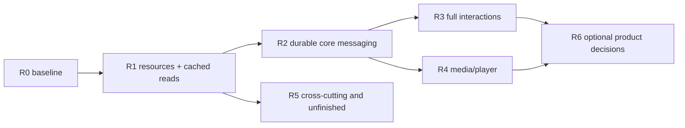

# Solid restoration checklist

> **Restoration checklist, with a verified bounded R1 slice.** Unchecked items
> are not completion claims. The current read-only slice is described by the
> [frontend architecture](frontend-architecture.md) and
> [engine inbox contract](engine-inbox-contract.md).
>
> Audit date: **2026-09-10**.

## How to read this plan

This document separates four things which the historical issue statuses alone
cannot separate:

1. **Current baseline:** behavior present in the Solid 2 production runtime.
2. **Restoration:** behavior evidenced in the retired implementation that must
   be rebuilt through the current worker contracts.
3. **Unfinished backlog:** intended behavior that was not fully delivered or
   verified, even if adjacent code existed.
4. **Optional new scope:** ideas without evidence that they were shipped core
   behavior. These are not restoration commitments.

A completed bean does not mean its behavior exists in Solid, and a todo bean
does not prove its behavior never shipped. Likewise, scrapping an old
Svelte/Teact design does not reject later restoration of the user behavior.
The appendix preserves bean statuses at the September 10 audit. Current delivery
status lives in the R0–R5 milestone beans; later edits to historical beans do not
retroactively change that audit.

The retired behavior reference is commit `d001f89`. Inspect it without restoring
deleted files into the working tree:

```sh
git show d001f89:docs/frontend-architecture.md
git show d001f89:entrypoints/ui/history.browser.test.ts
git show d001f89:entrypoints/ui/store.test.ts
```

The most recent old editing/comment behavior is also present in ancestor
`88b973d`. Current `lib/domain.ts`, catalog, handlers, and parsers are protocol
evidence only: their presence is not a runtime feature. The
[`solid-2-successor-review.md`](solid-2-successor-review.md) is a historical review,
not the current roadmap or implemented state. Teact has already been eliminated; no phase
restores its store, adapters, harness, or root force-render mechanism.

## Ordering and ownership

The active work is **R1: resource-scoped persistence and cached
conversation reads**, not a large framework build-out. R2 remains blocked until
R1 acceptance and the quality gates are complete.

The bounded read-only implementation passes the full 106-test quality gate;
see [R1 verification](r1-verification.md). R1 is not closed: complete retention
for active/recent histories, inactive-conversation eviction, and remaining
acceptance/performance evidence are still open. Code presence alone does not
check off an acceptance criterion.

The former `replaceInbox` deleted all account facts and was valid only for the
one-resource baseline. R1 replaces it with atomic resource-scoped writes,
transitive reference-aware retention, and a tested v1 schema migration. Do not
reintroduce account-wide replacement as a convenience for any single resource.

Keep one canonical worker. The worker owns RPC, identity, persistence,
single-flight, resource generations, and canonical facts. Solid projects worker
state and owns only route, draft, focus, and scroll state local to its window.
Keep the shared `commitRevision` and current account identity rules. Distinguish
the `ds_user_id` storage account, message viewer identity, and thread
key/`fbid`/`igid`; none are interchangeable.



Phases may be split into small vertical pull requests. Do not pre-create a
massive empty module tree.

## R0 — Current baseline and release evidence

### Implemented baseline

- [x] **R0.1 — Solid 2 runtime.** One `/ui.html` production page with no retired
      frontend authority.
- [x] **R0.2 — Read-only cache.** Account-authorized, normalized first-page
      snapshots are persisted in IndexedDB and explicitly refreshed/retried.
- [x] **R0.3 — Bounded inbox.** Stable domain keys, fixed 72 px rows, and at most
      31 mounted rows.
- [x] **R0.4 — Runtime checks.** The clean-restart runtime has focused tests,
      type/lint/build checks, and worker-owned identity/single-flight/stale-generation
      behavior. Historical test-count labels are audit snapshots, not timeless
      guarantees.

### Outstanding real-browser evidence

- [ ] **R0.5 — Installed extension path.** Record browser action launch,
      provider selection, account switch, and worker termination/restart in an
      unpacked build.
- [ ] **R0.6 — Cache states.** Record fixture/bundle identity and missing, warm,
      and retained-cold navigation input metrics. Separate mocked test evidence from
      live-account evidence.
- [x] **R0.7 — Live-account gate recorded.** No live-account or installed-extension
      path was verified in the September 13 session; see
      [R1 verification](r1-verification.md). If an account is unavailable, record the gate
      rather than blocking unrelated implementation or implying live verification.

The timing and size budgets in the quality section are targets until measured;
R0 does not claim them.

## R1 — Resource-scoped persistence and cached conversation reads

### Persistence and resource protocol

| Checklist                                     | Lowest owner / implementation                                                                                                                                                                                    | Focused acceptance                                                                                                                                                                                          |
| --------------------------------------------- | ---------------------------------------------------------------------------------------------------------------------------------------------------------------------------------------------------------------- | ----------------------------------------------------------------------------------------------------------------------------------------------------------------------------------------------------------- |
| [x] **R1.1 — Migrate v1 storage.**            | `lib/engine/db.ts`: migrate existing first-page data into explicit `inbox:primary` ownership without changing account identity or `commitRevision`.                                                              | A v1 database opens with the same authorized inbox; migration is atomic and repeatable.                                                                                                                     |
| [x] **R1.2 — Resource-scoped writes.**        | Engine DB: generalized explicit keys (`inbox:primary`, page/cursor ownership, `history:<thread>`), resource-to-fact references, and reference-aware deletion. Never hold network work inside an IDB transaction. | Refreshing one resource neither deletes nor reorders facts still referenced by another; writes/deletions remain partition-isolated, and any explicit whole-partition clear is defined only when introduced. |
| [ ] **R1.3 — Resource state.**                | Worker engine: per resource expose availability, freshness, sync state, cursor, exhaustion, last sync time, and typed error.                                                                                     | Missing, stale, refreshing, exhausted, and failed resources render distinctly without inventing cached success.                                                                                             |
| [ ] **R1.4 — Scoped single-flight.**          | Worker: one read flight per account/resource/cursor, bounded client interests, and session generation as routes subscribe/unsubscribe.                                                                           | Two windows share a request; stale generations cannot commit; losing all interests ends eligible detail work.                                                                                               |
| [ ] **R1.5 — Coherent snapshots.**            | Worker snapshot projector: retain account/worker epoch, client sequence, and global revision coherently across multiple resources.                                                                               | Gaps, duplicate/irrelevant commits, account changes, and snapshot races converge without cross-account state.                                                                                               |
| [x] **R1.6 — Keep full snapshots initially.** | Worker RPC: continue complete snapshots while payloads are small. Add scoped delta batches only after measurement.                                                                                               | No durable replay log, generic sync framework, or client-side canonical store is introduced speculatively.                                                                                                  |

### Inbox pagination

Historical evidence: retired sidebar pagination and preload behavior (`h7rl`) and
the `d001f89` tests. It must be rebuilt on resource ownership, not ported.

| Checklist                             | Lowest owner / implementation                                                                                           | Focused acceptance                                                                                                   |
| ------------------------------------- | ----------------------------------------------------------------------------------------------------------------------- | -------------------------------------------------------------------------------------------------------------------- |
| [ ] **R1.7 — Page resources.**        | Provider/parser preserve each exact opaque cursor; engine merges ordered thread IDs while retaining page ownership.     | Loading page 2 keeps page 1 and server pin facts; refresh does not erase history. Durable pin ordering begins in R2. |
| [ ] **R1.8 — Progress gates.**        | Engine cursor state detects duplicate cursors and successful responses that add no progress.                            | Duplicate/no-progress becomes a visible retryable resource failure, never an uncontrolled request loop.              |
| [ ] **R1.9 — Explicit continuation.** | Solid sends a load-more intent for the resource; the worker selects its current opaque cursor and provides retry state. | Previous pages stay usable while the next page fails or retries; UI never owns cursor selection.                     |

### Selection, routes, and layout

| Checklist                                      | Lowest owner / implementation                                                                                                   | Focused acceptance                                                                                                |
| ---------------------------------------------- | ------------------------------------------------------------------------------------------------------------------------------- | ----------------------------------------------------------------------------------------------------------------- |
| [x] **R1.10 — Cached selection.**              | Worker history subscription plus Solid route state opens cached facts first, then explicitly synchronizes.                      | Selecting a row does not discard inbox position and does not require a network response to show retained history. |
| [x] **R1.11 — Responsive route.**              | Solid: two panes on desktop; one real history route on compact screens with Back.                                               | Compact Back restores list window and keyboard focus; it is not a CSS-hidden second pane.                         |
| [x] **R1.12 — Resizable desktop sidebar.**     | Pointer/keyboard separator in Solid, initially window-local, clamped 280–520 px while leaving at least 320 px for conversation. | Pointer capture cleanup and keyboard resizing work; persistence waits for the global-settings service.            |
| [x] **R1.13 — Basic dark visual restoration.** | Solid tokens/media query, independently from a generic settings framework. A light/system choice is an optional later setting.  | All shipped dark surfaces are legible; no settings framework or empty rail placeholders are required.             |

### Bounded history and scrolling

The first R1 implementation retains at most 400 messages and 20 page segments per
conversation, 20 conversations per account, and 20 inbox segments. Its local
`retentionLimited` state is distinct from provider exhaustion, but the
per-conversation ceiling is transitional—not the intended cache policy.

`icr-itlg` replaces it with the simpler rule: retain all successfully loaded
pages for active and recent conversations; under account-level storage pressure,
evict whole least-recently-used inactive histories first. Do not build moving
per-conversation ranges or evict active/recent history merely to bound runtime
memory. Solid snapshots and worker working sets remain interest-bounded, and the
DOM still mounts at most 80 history rows.

Historical evidence: `7ycg`, `zmst`, `os6s`, `b6uv`, `jouw`, and `5uvl` plus
the retired history/store tests. The old unbounded/200-message buffer design is
superseded.

| Checklist                            | Lowest owner / implementation                                                                                                                           | Focused acceptance                                                                                                                            |
| ------------------------------------ | ------------------------------------------------------------------------------------------------------------------------------------------------------- | --------------------------------------------------------------------------------------------------------------------------------------------- |
| [ ] **R1.14 — History resource.**    | Engine/provider/parser: `history:<thread>` starts at newest and persists exact older cursors and normalized facts.                                      | Initial history is bounded and survives inbox refresh/account-safe restart.                                                                   |
| [x] **R1.15 — Local-first ranges.**  | Solid history projection asks for newer/older logical IDs already cached before network. Use a 40-message slice and mount no more than 80 message rows. | Scrolling within cached coverage performs no request and never expands the mounted window without bound.                                      |
| [ ] **R1.16 — Logical restoration.** | Solid stores visited logical message ID plus offset, not raw scroll height.                                                                             | Return to a conversation restores the same content position after measurement changes.                                                        |
| [x] **R1.17 — Stable prepend.**      | History viewport uses measurements/`ResizeObserver` to compensate prepends.                                                                             | Older-page insertion shifts the visual anchor by less than the provisional 1 px budget.                                                       |
| [ ] **R1.18 — Controlled fill.**     | Newer traversal is local-only. The older sentinel may fill a short viewport one page at a time through explicit progress/exhaustion gates.              | Exhaustion stops older reads; an empty/short page cannot trigger uncontrolled draining, and no nonexistent newer network endpoint is implied. |

### Message projection

Historical evidence: retired rendering/replies work (`vlgo`, `3br2`, `61iz`,
`4gws`) and surviving friendly parsing/date code (`a0ow`, `2on6`).

- [x] **R1.19 — Core content.** Project text, image, reel, post, inline/activity,
      unsupported, and reply-preview rows from normalized domain facts.
- [x] **R1.20 — Semantic and presentation derivation.** Provider/parser code owns
      friendly inbox/unsupported semantic summaries and numeric timestamp
      normalization. Solid derived viewport selectors own localized dates/times,
      sender grouping, and avatar layout without adding worker/cache grouping
      entities. Derive incoming/group avatars and one-to-one peer presentation from
      canonical `isGroup` and participant facts; do not infer Instagram account
      privacy, which the current `User` contract does not expose.
- [x] **R1.21 — Unavailable facts.** Render captured unavailable shares as an
      intentional accessible placeholder, distinct from network failure, with no
      futile fetch loop.
- [x] **R1.22 — Read remains explicit.** Merely opening or scrolling history must
      not mark it read before the durable command stage exists.

Acceptance for R1.19–R1.22: each supported fixture has stable keys and accessible
fallback text; malformed/unsupported content cannot reset the resource; date and
sender grouping remain correct across a prepend boundary.

## R2 — Durable core messaging

### Outbox and optimistic projection

Historical evidence: retired mutation foundation (`9qjx`), send/reply (`4an3`),
pin (`gyo4`), and hardening (`gi4a`). These behaviors must use the new engine,
not archived mutation stores.

| Checklist                                     | Lowest owner / implementation                                                                                                                                                                                                                                                                       | Focused acceptance                                                                                                                                         |
| --------------------------------------------- | --------------------------------------------------------------------------------------------------------------------------------------------------------------------------------------------------------------------------------------------------------------------------------------------------- | ---------------------------------------------------------------------------------------------------------------------------------------------------------- |
| [ ] **R2.1 — Durable acceptance and dedup.**  | Engine transaction persists `(accountId, operationId, immutable payload)`, target, stage, attempts, and outcome before dispatch. Identical redelivery returns the same acceptance; the same ID with a different payload is rejected; distinct user commands remain distinct even when text matches. | Accepted commands survive restart. Storage-quota/write failure rejects acceptance and causes zero provider calls.                                          |
| [ ] **R2.2 — Canonical facts plus overlays.** | One pure projector combines canonical server facts with ordered operation overlays. Matching receipts commit facts; failures roll back or retain a failed-send row per operation.                                                                                                                   | Worker and client use the same pure projector for speculation; an accepted revision replaces same-frame speculation without flicker or double application. |
| [ ] **R2.3 — Target serialization.**          | Worker serializes commands per target and durably records attempts/unknown outcomes.                                                                                                                                                                                                                | Restart cannot concurrently dispatch the same target; retry eligibility requires explicit operation evidence, not an upstream exactly-once assumption.     |
| [ ] **R2.4 — First commands.**                | Closed provider methods implement send/reply, pin/unpin, and paired read marking.                                                                                                                                                                                                                   | Every command has strict input/receipt validation and account/target checks.                                                                               |

### Composer and send lifecycle

- [ ] **R2.5 — Local composer state.** Keep per-window, per-thread draft,
      reply/edit intent, focus, and validation in Solid; handle Enter, Shift+Enter,
      and IME composition correctly.
- [ ] **R2.6 — Acceptance semantics.** Clear the submitted draft only when the
      worker accepts the immutable operation; preserve it on rejection.
- [ ] **R2.7 — Pending controls.** Show pending/failed messages with eligible
      Retry and Remove. Alias local ID to server ID while preserving stable DOM
      identity.
- [ ] **R2.8 — List effects.** Reconcile inbox snippet/order and either follow the
      bottom or preserve the current anchor according to pre-send position.

Acceptance: restart and two-client tests show one durable operation, no duplicate
provider dispatch, stable optimistic content, and no stolen draft from another
window.

### Pins, reads, and incoming repair

- [ ] **R2.9 — Authoritative pins.** `PinThreadResult` returns `threadFbid` and
      `isPinned`; validate that target/state against the command account and epoch.
      The worker derives and persists pin order from acceptance order—no upstream
      order field is implied. Never globally reassign pins during account switch. An old
      storage-pin migration is needed only if reintroduced, and must be opt-in for a
      verified account; porting old settings is not required.
- [ ] **R2.10 — Paired read mutations.** Target thread `igid`, latest message ID,
      and timestamp together. Maintain a watermark, coalesce the same latest value,
      and prevent a newly arrived message from being rolled back to read.
- [ ] **R2.11 — Interest-driven polling fallback.** The worker alone polls known
      inbox/detail queries for visible interested clients, stops with no interests,
      and reconciles facts plus overlays without root reset. Historical 5 s active /
      60 s backed-off timing is a benchmark to remeasure, not a universal claim.
- [ ] **R2.12 — No competing authority.** Do not add independent client polling
      or always-on worker alarms.

Acceptance: two clients plus worker restart converge on the same pin/read/message
state; a stale poll response cannot erase overlays or newer facts.

## R3 — Full message interactions

### Reactions and editing

Historical evidence resolves an old contradiction: reaction removal was excluded
from the August 3 `9qjx` scope, but later UI/tests and the current
`setReaction(remove)` protocol evidence show it shipped. Restore the later
behavior.

- [ ] **R3.1 — Reaction rail.** Add/change/remove the viewer's reaction with six
      quick choices (default plus five) and accessible state.
- [ ] **R3.2 — Full picker.** Provide categorized, searchable keyboard navigation
      and normalize Unicode/VS16 at the domain boundary.
- [ ] **R3.3 — Strict receipts.** Validate target and reaction arrays/fields;
      test stale server reads against optimistic overlays.
- [ ] **R3.4 — Timed edit.** Edit outgoing text within an inclusive 15-minute
      window, matching IDs and timestamp. Preserve draft/reply on cancel.
- [ ] **R3.5 — Edit reconciliation.** Retry with immutable IDs and retain receipt
      overlay until echo, using an explicit bounded policy (historically three merges
      or two minutes), never a silent eternal overlay.

### Forwarding

- [ ] **R3.6 — Supported sources.** Forward text, reels, and feed posts to at most
      five loaded targets; disable unsupported attachments with an explanation.
- [ ] **R3.7 — Target chooser.** Restore simple fuzzy filtering over loaded
      targets without a new dependency. When supplied, send and confirm the optional
      comment-before-share as its durable stage before the share stage.
- [ ] **R3.8 — Durable stages.** Give every target/stage an immutable ID; retry
      only incomplete stages after partial failure and never mutate source history.
- [ ] **R3.9 — Feedback.** Report partial completion and errors through global
      toasts/sync status retained across panes.

### Reply navigation

Historical reply-jump/prefetch beans were scrapped with their Svelte/TanStack
200-buffer design, but later Teact tests shipped bounded jumps, a return stack,
and prefetch. Restore the behavior without restoring that design or assuming an
around-message endpoint.

- [ ] **R3.10 — Local-first jump.** Search mounted/cached history first, then
      serially load older opaque cursors through the shared flight until found,
      exhausted, or failed.
- [ ] **R3.11 — Honest progress.** Show page/message counts, not a fabricated
      percentage. A click gets priority and may cancel speculative work.
- [ ] **R3.12 — Focused target.** Install a bounded target window, focus and
      highlight the exact message, and push the prior logical position to a return
      stack.
- [ ] **R3.13 — Return/newest.** Pop exact positions and provide an explicit
      newest control.
- [ ] **R3.14 — Bounded prefetch.** Near-viewport reply previews may queue four
      targets, at most one page each; cancellation and route changes release work.

### Menus, keys, clipboard, and errors

- [ ] **R3.15 — Context menu input.** Support right-click, ContextMenu,
      Shift+F10, and compact 500 ms long-press. Cancel long-press after 10 px movement
      or cancellation and suppress the generated click.
- [ ] **R3.16 — Context menu behavior.** Clamp to viewport, dismiss correctly,
      restore focus, and show no action unsupported by the message/protocol.
- [ ] **R3.17 — Physical shortcuts.** J/K/H/L navigate pane/rows; Ctrl+O returns
      or goes newest even from composer unless a contextual surface/dialog owns
      input; Enter activates a reply-preview target before a share action; Space
      toggles heart.
- [ ] **R3.18 — Shortcut exclusions.** Editors, modifiers, and nested native
      controls suppress shortcuts except the documented Ctrl+O composer behavior.
      Row/pane movement does not paginate or expand the viewport; selecting an inbox
      row may naturally subscribe to/load that thread.
- [ ] **R3.19 — Copy post URL.** Copy the parser-provided canonical target URL and
      announce keyboard-accessible success/failure.
- [ ] **R3.20 — Global feedback.** Toast and synchronization errors survive pane
      transitions and retain actionable failure detail.

Focused R3 acceptance: the same row survives reaction/edit receipts; partial
forward retry never repeats settled stages; a missing reply target shows a
recoverable error; target/return and keyboard movement cause no unintended page
fetch; focus restoration and long-press produce no click-through.

## R4 — Media, player, and engagement

### Media data and loading

- [ ] **R4.1 — Normalize metadata.** Store media, users, comments, and query
      records by IDs; map shortcode-to-media identity. Persist metadata only—never media
      bytes or avatar data URLs.
- [ ] **R4.2 — Closed media protocol.** Use current captured REST media-info and
      shortcode lookup evidence with shared parsers. Components receive domain data,
      never raw document IDs or protocol payloads.
- [ ] **R4.3 — Account/resource retention.** Media facts participate in R1
      references, so inbox/history refresh cannot erase still-used metadata.
- [ ] **R4.4 — Lazy route code and read scheduling.** Load the route chunk on
      intent. The starting budget is 2 concurrent media reads, 2 likely-chat
      warmups, 1 adjacent older-history page, and 4 queued reply targets processed
      serially at one page each. Historical delayed two-chat warmups (100/200 ms) are
      only a policy to reuse if measurement supports it. Historical 8 means
      speculative media starts per store lifetime, not concurrent work; remeasure a
      worker-lifetime/interest budget, and never limit visible or explicit intent by
      that speculative-start budget. Pull chat/history warmups into the R1/R2 read
      scheduler when relevant rather than waiting for the media phase.
- [ ] **R4.5 — Stable previews.** Reserve actual-aspect geometry up to the historic
      300×300 preview; inline previews never autoplay. Retain thumbnails until playable content is
      ready rather than flashing blank.
- [ ] **R4.6 — Safe avatars.** Reintroduce fetch/proxy support only when needed,
      with HTTPS, 2 MiB maximum, no redirects, exact CDN permission, and disposable
      object/data URLs that are never persisted.
- [ ] **R4.7 — Intentional unavailable card.** Give unavailable shares accessible
      retained metadata and no repeated fetch.
- [ ] **R4.8 — Media-forward history card.** Restore compact author, borderless
      media, external reaction, and time-on-hover behavior.

### Modal and custom player

Old custom-player/mute beans remained todo even though the behavior later
shipped. Restoration follows implementation/test evidence, while new gestures
remain R5 proposals.

- [ ] **R4.9 — Accessible modal.** Trap/restore focus, inert the background, lock
      scroll, close outside/on Escape, and use aspect-aware desktop presentation plus
      a compact full-screen sheet.
- [ ] **R4.10 — Player basics.** An explicitly opened new modal item may begin
      playback when the browser permits; an item explicitly paused earlier remains
      paused. Support play/pause, blocked-playback reporting, seek, time, and
      fullscreen with native media semantics.
- [ ] **R4.11 — Variant quality.** Switching quality preserves current time,
      playback rate, volume/mute, and play intent.
- [ ] **R4.12 — Carousel isolation.** Keep independent per-item state; forced
      muting of a slide video must not overwrite the user's global preference.
- [ ] **R4.13 — Player gestures/keys.** Distinguish Space/tap from a 250 ms 2×
      hold with cleanup; support comma/period one-frame stepping (1/30 fallback) and
      arrows without leaking into global shortcuts.
- [ ] **R4.14 — Controls visibility.** Keep controls visible with focus; otherwise
      treat the historical initial 10 s idle / 1.5 s pointer-leave policy as a
      starting point, not a measured SLA.
- [ ] **R4.15 — State authority.** Playback position/paused state is per window.
      Global volume/mute uses one `storage.local` service and only adds permission
      when that persistence ships.
- [ ] **R4.16 — Attached audio/music.** Render title/artist/offsets; keep the
      soundtrack across slides, pause it on close, force slide-video mute without
      changing user preference, and report blocked playback.
- [ ] **R4.17 — Signed URL refresh.** Keep modal/metadata mounted while the worker
      performs one forced shared refresh; show explicit Retry on failure.
- [ ] **R4.18 — Safe export.** Carry the parser-provided `targetUrl` in the open
      intent for Copy. Download only when actual parser fields establish signed-CDN
      URL eligibility. Never invent a `shareURL` contract or download endpoint.

### Comments and engagement

- [ ] **R4.19 — Lazy comments.** Start only after modal open/media ready. Preserve
      exact top-level and child cursors and explicit server pagination.
- [ ] **R4.20 — Comment budget.** Choose and test a mounted-comment budget before
      shipping; historical evidence is not strong enough to claim the history
      80-row limit for comments.
- [ ] **R4.21 — Like/save/comment reactions.** Route media like/save and comment
      like/unlike through the durable outbox with strict receipt identity.
- [ ] **R4.22 — Create/reply comments.** Enforce the 2200-character limit and
      persist every accepted intent. Known success reconciles receipt, entity, and
      parent. Because there is no proven reliable client key for this non-idempotent
      action, mark only lost/uncertain outcomes `outcome_unknown` and never blindly
      replay them.
- [ ] **R4.23 — Social cue integrity.** Show at most five named likers only with
      proof they are viewer-followed; optional ranked-comment same-author cues are
      allowed. Never infer arbitrary “friends.”

Acceptance for R4 includes geometry, cleanup race, optimistic rollback, and
account/resource-scope tests in addition to parser fixtures.

## R5 — Unfinished backlog and preferences

Motion settings may ship in this phase, but accessibility does not wait for R5:
every animation restored earlier must already honor system reduced-motion and
must not animate placement/layout. Likewise, pull the single settings service
forward when the first persistent setting ships rather than creating a temporary
authority.

### Motion

- [ ] **R5.1 — Explicit global preference.** Offer System, Reduced, and Full in a
      single settings authority; subscribe to live OS changes.
- [ ] **R5.2 — Gate before mount.** Resolve the preference before mounting every
      transition/spinner. Motion choices do not alter network policy or autoplay.
- [ ] **R5.3 — Safe motion scope.** Never animate row position, layout, or history
      anchor maintenance. Animate only a newly accepted tail entry, not cached or
      prepended rows.
- [ ] **R5.4 — Lifecycle/focus.** Add retained exits only for concrete surfaces;
      Reduced removes timers and restores focus immediately. Test reopening during
      close. Do not copy Teact mechanisms or add a generic animation framework.

### Preferences and protocol diagnostics

- [ ] **R5.5 — Wheel controls need opt-in.** Volume/speed wheel behavior remains a
      proposal until it has a discoverable opt-in or explicit control target that
      cannot hijack page scroll. Clamp values and test mouse, trackpad, and keyboard
      alternative; do not invent an arbitrary gesture.
- [ ] **R5.6 — Passive descriptor monitor.** A MAIN-world observer may record
      GraphQL operation names, document IDs, endpoint, and timestamp only—never
      tokens or message text, and never auto-update protocol values.
- [ ] **R5.7 — Narrow stale-operation errors.** Diagnose a captured stale
      operation/error taxonomy without scraping provider internals in UI.
- [ ] **R5.8 — Iris/MQTT evidence gate.** Require a fresh authenticated capture
      and two-account manual validation. Observe Instagram's own client; do not build
      a new raw MQTT client. Polling remains the one repair authority and must not be
      duplicated. `qq3b` therefore remains a gap.
- [ ] **R5.9 — Optional offline partition.** Current cached UI does not
      authenticate an unknown offline account. Any later offline choice must be
      explicitly labeled read-only and include export, clear, retention, and privacy
      decisions rather than silently falling back.
- [ ] **R5.10 — Settings ownership.** Keep small global preferences in one
      `storage.local` service with cross-client broadcasts; account settings remain
      separate. Add permissions only with the consuming feature.
- [ ] **R5.11 — Friendly-state audit.** Recheck friendly unsupported and
      unavailable copy against fresh fixtures; its rendering foundation belongs to
      R1, while broad copy review remains unfinished.

## R6 — Optional extensions, not restoration commitments

These require separate product and protocol decisions. They must not appear as
working controls, empty navigation destinations, or capability adapters merely
because parsers/types exist.

- [ ] **R6.1 — Watch history (optional).** Define meaningful playback sessions,
      coalescing, retention, privacy, and Clear before recording anything.
- [ ] **R6.2 — Engagement event history (optional).** Local operation events for
      likes/saves may be recorded with retention, but cannot claim to reconstruct
      complete Instagram history.
- [ ] **R6.3 — Route rail (optional).** Add a rail only after multiple real
      destinations ship; no empty placeholders.
- [ ] **R6.4 — Protocol-only inbox features (new scope).** Requests/Spam folders,
      unread counts, richer thread info/message actions, message pinning, cutout
      stickers, composer trays, emoji/stickers/music/avatar, automatic-preview
      settings, and richer sends require fresh API proof before commands are added.
- [ ] **R6.5 — Unevidenced communication features (new scope).** Typing, online
      status, remote-seen indicators, attachments/upload, deletion/unsend, search,
      conversation mute, and new-conversation creation were not formerly shipped
      core behavior. Treat each as an evidence gap, not restoration.
- [ ] **R6.6 — Shell redesigns (optional).** Foldable sidebar and a generic
      settings page need current product decisions; do not blindly revive scrapped
      Svelte structures.

## Quality gate for every slice

- [ ] Run `npm test`, `npm run check`, `npm run lint`, `npm run build`,
      `git diff --check`, and the repository shared `ast-grep` scan.
- [ ] Split tests by feature/owner. Restore key behavioral assertions via
      `git show`, rewritten for current contracts; do not restore the retired Teact
      harness or one giant suite.
- [ ] Cover offline unknown-identity recovery, account changes, epoch/sequence
      gaps, duplicate/irrelevant commits, and snapshot races as multi-resource state
      is introduced.
- [ ] Prove memory, DB, and outbox bounds/eviction and that no network request is
      held inside a database transaction.
- [ ] Keep real installed-browser/live-account release evidence separate from
      mocked provider/browser tests.
- [ ] Enforce **hard mount invariants** of at most 31 inbox rows and 80 history
      rows. Use 1,000 normalized IDs as a test fixture size, not a snapshot
      cardinality requirement. Keep merge/window work below a provisional 50 ms
      maximum main-thread task; this is not a new input-response SLA.
- [ ] Treat p95 100 ms warm navigation and p95 300 ms authorized retained-cold
      navigation as provisional targets. Same-frame speculative feedback is distinct
      from durable worker acceptance/acknowledgement and must be measured separately.
- [ ] Measure end-to-end navigation from input/UI entry to visible content; do
      not start the stopwatch after identity or chunk readiness. Record readiness and
      account status, separate eligible warm/authorized-cold cases from absent
      identity/missing cache, and report those gate costs rather than hiding them.
      Identify fixture, browser, hardware, and cache state.
- [ ] Record the current clean bundle before the relevant slice and target no
      more than +15 KiB gzip for the incremental feature proposal. Revisit and agree
      the budget before a large restored scope rather than applying 15 KiB to all
      restoration. Never claim a performance win from comparing against a retired
      bundle that contained more features.

## First implementation slice

The first pull request should deliver one vertical path, not scaffolding:

1. Migrate a v1 database safely to explicit resource ownership.
2. Upsert/read resources without cross-resource deletion.
3. Preserve the current first-page inbox behavior and tests.
4. Add inbox next-page persistence plus cached history subscription/selection
   with one bounded initial newest-history window.
5. Add a regression proving inbox refresh does not erase cached history.
6. Add no mutation before R2 and no parallel legacy authority.

Acceptance: reopen a migrated database, authorize the same account, show the
retained first inbox page, fetch/store another inbox page and one conversation,
refresh the first page, and still read the other page and conversation. Account
switch and stale-generation tests must remain authoritative.

## Bean inventory audit (all 37)

“Disposition” maps each historical record to exactly one primary checklist area;
overlapping work is intentionally merged rather than duplicated. Stored statuses
are copied without modification.

| Bean                                                                                            | Stored status | New disposition / primary task                                                                   |
| ----------------------------------------------------------------------------------------------- | ------------- | ------------------------------------------------------------------------------------------------ |
| [`icr-7ycg`](../.beans/archive/icr-7ycg--chat-history-ux-lazy-preloading-and-bottom-navigat.md) | completed     | Restore bounded history navigation in R1.15–R1.18.                                               |
| [`icr-zmst`](../.beans/archive/icr-zmst--chat-history-ux-message-cache-and-stable-state.md)     | completed     | Superseded by resource cache and logical restoration, R1.14–R1.16.                               |
| [`icr-os6s`](../.beans/archive/icr-os6s--chat-history-ux-scroll-preservation-and-non-resett.md) | completed     | Restore stable prepend/non-reset behavior, R1.16–R1.18.                                          |
| [`icr-9qjx`](../.beans/icr-9qjx--dm-mutations-foundation-refactor.md)                           | completed     | Rebuild durable mutation foundation in R2.1–R2.4; archived send/reaction/hardening overlap here. |
| [`icr-3br2`](../.beans/archive/icr-3br2--render-message-replies.md)                             | completed     | Restore reply previews in R1.19 and jumps in R3.10–R3.14.                                        |
| [`icr-b6uv`](../.beans/archive/icr-b6uv--teact-message-history-and-infinite-scroll.md)          | completed     | Restore behavior via R1.14–R1.18; Teact implementation is rejected.                              |
| [`icr-61iz`](../.beans/icr-61iz--telegram-style-shared-post-history.md)                         | completed     | Restore clean-room shared-post projection, R1.19 and R4.8.                                       |
| [`icr-4gws`](../.beans/icr-4gws--make-shared-posts-media-forward-in-history.md)                 | completed     | Restore media-forward cards in R4.8.                                                             |
| [`icr-c5ud`](../.beans/icr-c5ud--lazy-preload-and-cache-reel-info.md)                           | completed     | Rebuild resource-owned media loading/caching, R4.1–R4.5.                                         |
| [`icr-iqhf`](../.beans/icr-iqhf--replace-hover-reaction-button-with-reaction-rail-a.md)         | completed     | Restore reaction rail/picker, R3.1–R3.3.                                                         |
| [`icr-2on6`](../.beans/archive/icr-2on6--investigate-message-dates-becoming-epoch.md)           | completed     | Preserve numeric-string timestamp/date tests in R1.20.                                           |
| [`icr-5uvl`](../.beans/archive/icr-5uvl--chat-history-ux-manual-qa-and-performance-verifica.md) | completed     | Re-run relevant browser and budget evidence under the quality gate.                              |
| [`icr-rvb8`](../.beans/icr-rvb8--add-focused-message-enter-and-space-shortcuts.md)              | completed     | Restore scoped physical shortcuts, R3.17–R3.18.                                                  |
| [`icr-h7rl`](../.beans/archive/icr-h7rl--add-infinite-scroll-with-preloading-to-chat-sideba.md) | completed     | Restore cursor-safe inbox pagination, R1.7–R1.9.                                                 |
| [`icr-lb3r`](../.beans/icr-lb3r--make-chat-sidebar-horizontally-resizable.md)                   | completed     | Restore bounded desktop resize, R1.12; persistence waits for R5.10.                              |
| [`icr-vlgo`](../.beans/archive/icr-vlgo--improve-chat-message-rendering-ux.md)                  | completed     | Restore message projection/grouping in R1.19–R1.21.                                              |
| [`icr-llfi`](../.beans/archive/icr-llfi--record-browser-exploration-baseline.md)                | completed     | Historical evidence only; repeat current installed-browser evidence in R0.5–R0.7.                |
| [`icr-gyo4`](../.beans/icr-gyo4--add-a-pinunpin-action-to-conversation-rows.md)                 | done          | Restore authoritative durable pins, R2.4 and R2.9.                                               |
| [`icr-z4vy`](../.beans/icr-z4vy--make-all-ui-motion-optional-and-animation-safe.md)             | todo          | Unfinished motion preference and lifecycle, R5.1–R5.4.                                           |
| [`icr-a0ow`](../.beans/icr-a0ow--use-friendly-inbox-and-unsupported-message-summari.md)         | todo          | Surviving parser/date work is evidence; complete UI audit via R1.20–R1.21 and R5.11.             |
| [`icr-0tpu`](../.beans/icr-0tpu--improve-reel-player-ux.md)                                     | todo          | Restore evidenced player UX in R4.9–R4.18.                                                       |
| [`icr-yvm4`](../.beans/icr-yvm4--make-unavailable-shares-an-intentional-card-state.md)          | todo          | Finish intentional unavailable state, R1.21 and R4.7.                                            |
| [`icr-tniw`](../.beans/icr-tniw--add-scroll-controlled-reel-volume-and-speed.md)                | todo          | Optional gated wheel interaction, R5.5; not silent restoration.                                  |
| [`icr-1xh8`](../.beans/icr-1xh8--build-a-custom-reel-player.md)                                 | todo          | Later implementation evidence overrides old todo for restoration, R4.10–R4.16.                   |
| [`icr-mfim`](../.beans/icr-mfim--remember-reel-mute-preference.md)                              | todo          | Later implementation evidence overrides old todo; one preference authority, R4.12 and R4.15.     |
| [`icr-i4mm`](../.beans/icr-i4mm--detect-stale-instagram-graphql-doc-ids-from-page-r.md)         | todo          | Unfinished passive diagnostics only, R5.6–R5.7.                                                  |
| [`icr-qq3b`](../.beans/icr-qq3b--synchronize-incoming-instagram-dm-updates.md)                  | in-progress   | Polling existed, but passive feed/two-account live QA remains open, R2.11–R2.12 and R5.8.        |
| [`icr-kphj`](../.beans/archive/icr-kphj--lazy-older-message-buffer-above-viewport.md)           | scrapped      | Old buffer superseded by bounded 40/80 local-first window, R1.15–R1.18.                          |
| [`icr-5say`](../.beans/archive/icr-5say--render-and-leave-reactions.md)                         | scrapped      | Behavior merged into durable reaction work, R3.1–R3.3; no archived adapter.                      |
| [`icr-pdaz`](../.beans/archive/icr-pdaz--scrolltomessage-api-for-reply-navigation.md)           | scrapped      | Old API replaced by bounded logical jump, R3.10–R3.14.                                           |
| [`icr-4an3`](../.beans/archive/icr-4an3--send-messages-and-replies.md)                          | scrapped      | Behavior merged into durable outbox/composer, R2.1–R2.8.                                         |
| [`icr-03bb`](../.beans/archive/icr-03bb--virtualized-chat-history-foundation.md)                | scrapped      | Old virtualizer replaced by bounded history contract, R1.15–R1.18.                               |
| [`icr-jouw`](../.beans/archive/icr-jouw--chat-history-scroll-qa-and-performance-hardening.md)   | scrapped      | Assertions inform R1.16–R1.18 and the quality gate; no retired suite port.                       |
| [`icr-gi4a`](../.beans/archive/icr-gi4a--refresh-and-mutation-ux-hardening.md)                  | scrapped      | Behavior merged into R2 durable receipts and R3.20 feedback.                                     |
| [`icr-5npn`](../.beans/archive/icr-5npn--reply-target-prefetch-and-ux-integration.md)           | scrapped      | Later bounded prefetch evidence restored in R3.10–R3.14, not the old 200 buffer.                 |
| [`icr-gbx1`](../.beans/archive/icr-gbx1--add-dark-theme-and-settings-page-to-appsvelte.md)      | scrapped      | Split: restore dark theme at R1.13; generic settings page remains optional R6.6.                 |
| [`icr-w5fx`](../.beans/archive/icr-w5fx--make-chats-sidebar-foldable-and-resizable.md)          | scrapped      | Resize is subsumed by `lb3r`/R1.12; foldability remains optional R6.6.                           |

Inventory total: **37** — completed 17, done 1, todo 8, in-progress 1,
scrapped 10. The implementation priority is deliberately not “finish todo
beans”: much completed historical functionality is absent from the current Solid
runtime and must first be restored on safe persistence and worker contracts.
